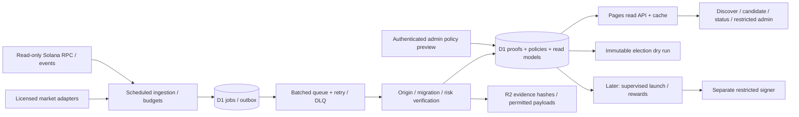

# Architecture and implementation plan

Status: proposed design, 20 October 2026. Preserve the empty homepage in this checkpoint. The first app implementation milestone is discovery, after the validation gates below.

## Architecture and isolation

Reuse `app/` React/Vite, Pages Functions, app shell and validated identity components. Add a `tenx` domain module rather than overloading Stonklets' stock-market spotlight. Propose a separate `TENX_DB` D1 binding, one ingestion Worker with a UTC minute scheduler, a batched work queue plus DLQ, and R2 evidence archives subject to provider rights. Use Workflows for multi-stage launch/settlement later, not one workflow per candidate per price update. Create no remote resources in this local-only phase.



Do not rewrite the framework for this milestone. Inspect existing API principal and admin authorization before reuse. The browser holds no provider keys. Local public previews must not expose unauthenticated admin writes or debug endpoints. Deployment requires a later user instruction; the existing GitHub deployment workflows target `main`/`dev`, so push only a `codex/` feature branch during this phase.

## Data and adapter contracts

All schemas are strict TypeScript plus runtime validation. Addresses retain chain-specific case rules: Solana addresses are case-sensitive; EVM canonical bytes/checksummed display differs. Every monetary token amount uses integer base units serialized as decimal strings; market prices use a decimal representation, not binary floating point for financial settlement. Store UTC times and explicit units.

```ts
type EvidenceStatus = "verified" | "unverified" | "rejected" | "unavailable";
type Evidence = {
  source: string; sourceVersion: string; observedAt: string; fetchedAt: string;
  payloadHash: string; signature?: string; slot?: string; instructionIndex?: number;
};
type GraduationProof = {
  chain: string; mint: string; launchpad: string;
  createdAt: string | null; graduatedAt: string | null;
  creation: Evidence | null; migration: Evidence | null;
  market: string | null; status: EvidenceStatus; reasonCodes: string[];
};
interface GraduationVerifier {
  verify(chain: string, mint: string): Promise<GraduationProof>;
}
interface MarketAdapter {
  capabilities: { batchSize: number; licenseStatus: string; quotaPerMinute: number };
  discover(cursor: string | null): Promise<unknown>; // validate into domain leads
  refresh(chain: string, addresses: string[]): Promise<unknown>;
}
```

The concrete normalized lead/snapshot schemas, timeouts and source-specific payload limits are implementation deliverables. Persist null for missing supply/market cap; never fill it with FDV. `createdAt` and `graduatedAt` are onchain observations, not API fetch times. A proof and a current market quote have separate freshness requirements.

### Graduation certification

First adapter: Pump → canonical PumpSwap, from pinned official program/IDL revisions referenced in the provider memo. Verify transaction success, finalized slot, matching create/migrate instruction, mint and derived curve/pool authorities, quote mint and initialized reserves. Resolve original token creation independently of pool creation. Reconcile rollback/orphaning before publishing eligibility; keep cursor/watermark, never infer history from a missing RPC result. Include legacy and current instructions, inner instructions, fake emitters, completed-but-unmigrated curves, unrelated new pools and old tokens in the fixture corpus.

For every additional Solana launchpad or EVM chain, certification records factory/program/code revision, creation event, migration event/state transition, destination pool relationships, finality model, archive availability and false-positive fixtures. Unknown adapters return unverified and cannot produce a live winner. Robinhood production chain identity, RPC availability and supported launch protocols are unverified; no guessed chain ID or deployments.

### Eligibility and ranking

Evaluate `now - verified createdAt` in `[0, 24h]`; future timestamps fail. Preserve separate graduation time. Recheck age/market/risk at publication and election snapshot, not only admission. Default candidate cap is 100 globally. Sort only qualifying candidates with a versioned deterministic score, then timestamp and canonical asset identity as tie-breakers; the quality display score is not a hidden replacement for later community backing.

Missing mandatory creation/migration evidence means provisional/excluded. Unknown mint/freeze/transfer permissions or holder data must follow the versioned policy, with explicit reason codes. Approximately $100K market cap remains the product starting target; $25K liquidity and concentration/volume formulas remain proposed sandbox parameters until approved. No fabricated holders, verified buyers, live metrics or safety claims.

## Proposed D1 model and constraints

Executable migrations will use a separate `tenx_` namespace and be tested against an empty local store and upgrade fixtures. This is a schema specification, not applied SQL.

| Table | Principal columns / constraints |
|---|---|
| `tenx_chains` | chain PK, family, discover/vote/launch flags, official RPC ref, local-$10X asset; flags independent |
| `tenx_assets` | asset ID, chain, address, symbol, decimals, chain creation time, supply proof; UNIQUE(chain,address) |
| `tenx_proofs` | asset, kind(create/migrate/authority/holder), source/IDL version, tx/slot/instruction, chain time, hash, status; UNIQUE(chain,tx,instruction,kind) |
| `tenx_pools` | chain+address unique; base/quote asset FKs; factory/program, initialized/reserve evidence |
| `tenx_market_samples` | asset, source, observed/fetched times, nullable price/cap/FDV/liquidity/volume; UNIQUE(asset,source,observed_at) |
| `tenx_risk` | asset, policy version, evidence hash, assessed time, status and reason codes; append assessments |
| `tenx_cycles` | ID, UTC open/close, policy hash, state, immutable input hash, proposed winner; one open policy per cycle |
| `tenx_candidates` | cycle+asset PK, status, score, admitted/expires times; indexed status/expiry/score |
| `tenx_read_models` | model ID, revision, as_of, source ages, payload, hash; atomic compare-and-swap publication |
| `tenx_policies` | version PK, effective time, canonical JSON/checksum, actor/approver/reason, staged/active/superseded |
| `tenx_jobs` | idempotency key unique, type, input hash, state, attempts, lease expiry, retry time, trace ID |
| `tenx_outbox` | event ID unique, aggregate/revision, payload hash, dispatched/ack status; transactional with domain update |
| `tenx_usage` | provider+UTC day+operation PK, reserved/used counts, allowed budget; atomic conditional increments |
| `tenx_audit` | event ID, actor, action/object, before/after hashes, reason, timestamp, trace ID; append-only app access |
| `tenx_incidents` | severity, affected source/job, start/end, reason, remediation |

Later migrations add accounts/linked wallets/challenges, finalized trades, vote scores, launches/steps, positions/fee rights, campaigns/periods/submissions, Warplet/boost snapshots, trader seasons, entitlements, claims and treasury asset ledgers. Preserve UNIQUE(chain,tx,event-index), UNIQUE(launch,step), UNIQUE(campaign,period,beneficiary,asset) and UNIQUE(season,beneficiary,asset). A singleton active-spotlight row (fixed primary key) references exactly one active edition. An immutable entitlement cannot change asset/beneficiary/amount after finalization. Record financial debits/credits per chain+asset and separate locked principal from fee receivables/receipts.

Atomic D1 batches and conditional state/revision updates enforce transitions, quota reservations, candidate publication, singleton spotlight and outbox writes. Never implement database admission with a non-atomic read-count-then-insert. If using D1 read replicas later, authority/lease/budget reads require primary-consistent semantics. Persist provider evidence before deriving material decisions.

## State machines and replay

- Lead: `DISCOVERED → VERIFYING → PROVISIONAL | ELIGIBLE | EXCLUDED`; `ELIGIBLE → EXPIRED | QUARANTINED`; re-evaluate only with new versioned evidence.
- Job: `PENDING → RUNNING → SUCCEEDED`; failure → bounded `RETRY_WAIT` or `DEAD_LETTER`. Expired leases are reclaimable with the same idempotency key. Consumer acknowledgment follows durable result persistence.
- Dry-run cycle: `OPEN → FREEZING → SNAPSHOTTED → DRY_RUN_COMPLETE | NO_ELIGIBLE_WINNER`. No deployment calls are reachable from this state machine.
- Later launch: PRD `PROPOSED → ELIGIBLE → WINNER_LOCKED → SIMULATED → FUNDED → TOKEN_CREATED → NATIVE_POOL_CREATED → OG_POOL_CREATED → TENX_POOL_CREATED → LOCKS_VERIFIED → ACTIVE → SPOTLIGHT_COMPLETE → ARCHIVED`; exceptions `BLOCKED`, `RECOVERY_REQUIRED`, `ABORTED`, `EXTENDED`.
- Later reward: `OPEN → SNAPSHOT → CHALLENGE → FINALIZED → CLAIMABLE → CLAIMED`; entitlement IDs survive retry/replay. Ten campaigns have separate immutable tranches and asset IDs.

External transactions require durable intent/config hash and reconciliation by stable signed transaction identity before retry. Never resend a new mint/payout because a response timed out. Workflow completion alone is not proof of chain execution. Partial pool creation never activates the spotlight.

## Read APIs, UI and identity

Initial APIs: `GET /api/10x/chains`, `/candidates`, `/candidates/:chain/:address`, `/cycles/current`, `/system/status`, `/transparency/policies`. Namespace avoids existing API collisions; public route aliases in PRD require a collision review. Define OpenAPI 3.1 and runtime request/response validators together during implementation. Envelope: `{api_version, trace_id, as_of, source_freshness, coverage, policy_version, data, next_cursor}`. Enforce `limit <= 100`, opaque cursor validation and bounded filters. Conditional caching keys include chain, filters, policy and read-model revision; private identity/admin responses use no-store and are never cached with public data.

Proposed admin APIs: authenticated `GET /api/10x/admin/jobs` and `/policies`; `POST /policies/preview`, `/policies/activate`, `/pauses`, `/cycles/:id/dry-run`. Writes use validated bodies, origin/CSRF controls for cookie sessions, rate limits and reason/audit records. Existing session ownership is insufficient to grant admin: explicit server-side allowlist/role and step-up approval for sensitive policy changes.

Future identity: one canonical account can link Solana/EVM wallets with one-time domain-separated challenges, issued-at/expiry, unique nonce and atomic consumption; verify correct chain/domain and reject replays. Farcaster proof does not automatically prove control of an arbitrary wallet. Warplet level/ownership is Base evidence tied to a signed wallet at a recorded block/time; ensure one NFT cannot multiply rewards across linked identities. Existing wallet/session code must be audited for these requirements before reuse.

Wireframe specification for the first slice:

```text
/discover                 /token/solana/:mint          /admin/10x
Chain + freshness         OG identity + full address   Auth boundary
Coverage / partial badge  Creation / migration proofs Jobs, cursors, source quotas
Eligible / provisional    Market cap distinct from FDV Policy preview + reasons
Ranked rows (<=100)       Risk + unknown indicators    Pause discovery / dry run
Empty / stale state       External Buy OG link         Audit / DLQ / retry status
```

Use responsive cards/table, keyboard-accessible filters, visible focus, status announced politely, no color-only verification, full copyable addresses and safe explorer links. Home remains empty until discovery UI is the agreed next implementation change. `/thesis` retains video, waitlist and social cards.

## Threat model

| Threat / trust boundary | Control | Required test/evidence |
|---|---|---|
| Malformed or malicious token metadata/API data → UI | Strict schema/size/time limits; escape text; safe URL protocols; no arbitrary HTML | XSS, Unicode impersonation, oversized JSON, invalid addresses |
| Content URL → server fetch | Allowlisted schemes, DNS/IP checks before each hop, private/link-local/metadata denial, bounded redirects/body/time | IPv4/IPv6 SSRF, redirect/DNS rebinding, compressed bombs |
| Provider lies/stale supply → eligibility | Distinct provenance, chain proof, nullable cap, freshness gates/quarantine | Old token/new pool, forged migration, stale market cap, FDV-only |
| Wallet/account → votes/claims | Domain-bound nonce, atomic consumption, finality, dedup, caps/funding-cluster/round-trip review | Replay, cross-domain signature, forked trades, wash rings |
| Warplet → boosts | Ownership/level snapshot, canonical beneficiary, raw rank frozen first | NFT sale/reuse and post-cutoff boost changes |
| Queue/admin retry → state | Leases, stable keys, transactional outbox, compare-and-swap revisions | Duplicate/redelivered/late events, concurrent publisher, crashed consumer |
| Admin/session → policy | Server authorization, origin/CSRF, staged diffs, immutable versions/approval | Unauthorized admin calls, mid-cycle policy mutation, leaked cached principal |
| AI/social content → operations | Untrusted data only; AI read-only aggregates; no signer/policy credentials | Prompt injection cannot activate code/config, spend, post or change recipients |
| Signer → chain | External signer, method/program/code-hash/beneficiary/chain allowlists, spend/slippage/gas caps | Arbitrary method/recipient, permission escalation, stale simulation |
| Launch/LP → public claims | Reconcile every pool/authority/lock/fee entitlement; no completion before proof | Third-pool failure, unlocked position, wrong fee collector, duplicate mint |
| Fees/rewards → treasury | Integer double-entry asset ledger, immutable entitlement, reserve ceilings | Principal/fees confusion, duplicate claims, cross-campaign/chain payout |
| Public traffic/scheduler → quotas | Shared cache, per-provider budgets, bounded queues/retries, degradation | 429 storm, D1 quota reached, 48h outage, no eligible day |

No claim that these controls eliminate sybil activity, scams or economic loss. New financial modules need their own review, protocol fixtures and audits.

## Exact simulation and devnet validation work package

This is the specification for the next experiment, **not an exact simulator or successful devnet proof**. Do not use a generic constant-product spreadsheet as protocol verification.

1. Pin DAMM program/SDK source revision and accepted mint types, decimals, token orientation, Q64.64/tick rounding, fee scheduler and protocol deductions. Freeze a reproducible scenario config hash.
2. For symbolic supply `S`, integer allocations are `50S/100`, `20S/100`, `20S/100`, `10S/100`; require exact divisibility or a founder-approved deterministic rounding policy. Do not choose the genesis supply implicitly. First two quote-pair opening inventories are ATTN-only, with zero OG and zero $10X deposited.
3. Use one ATTN/native price `pA`; if `pOG` and `p10X` are native/token, quote prices are `pA / pOG` and `pA / p10X`, after decimal/orientation conversion. Quote-only fee mode must be a verified protocol feature, not a simulated inventory conversion.
4. Use the protocol's exact math for native/OG/$10X entry and reverse swaps; first-trade sizes, ±1/5/20% reference mismatch, external quote moves, triangular arb, sequential pool creation, sandwich/sniper order, range exhaustion and failed lock/third pool. Report executable depth rather than ATTN allocation as liquidity depth.
5. Separate LP principal inventory, fee receivables, claimable quote receipts, protocol share, gas/rent and realized/unrealized P&L per asset. Compare secondary LP with hold and immediate conversion under the same synthetic paths. No live manipulative trading.
6. On local validator/devnet only, create test mints/pools, execute bounded test swaps, verify allocation, locked-position withdrawal failure and successful authorized fee claim; reject wrong beneficiary; reconcile crash/retry without duplicate mint. Save config, versions, exact commands, transaction signatures, slots, balance deltas and assertions. No devnet key or funded signer is assumed to exist now; request actual funding/authority when the concrete experiment is ready if needed.

## Milestone backlog

Estimates are engineering effort ranges for one engineer, excluding provider permission waits, audits and founder decisions. They are not delivery commitments.

| Epic / priority | User story and acceptance | Verification | Estimate |
|---|---|---|---|
| M0 / P0 source certification | Operator can inspect fixture evidence and provider permissions; unknowns never pass as verified | Pinned IDL/schema corpus; real successful and adversarial transactions; quota/429 tests | 3–5 days |
| M0 / P0 economics spike | Founder can review exact three-pool outcomes and devnet receipts | All simulation/devnet assertions above; no production signer | 5–10 days after config decisions |
| M1 / P0 domain + storage | Visitor sees canonical proof-backed candidate identity, risk and age | Migrations on empty/upgrade stores; 24h boundaries, unknown cap, dedup, global 100 cap | 2–3 days |
| M1 / P0 ingestion | App refreshes while operator absent; deterministic retry | Recorded provider fixtures, pagination limits, RPC gaps, duplicate queue, cursor replay | 3–5 days |
| M1 / P0 reads + screens | Visitor sees shortlist/details/freshness; operator sees jobs and preview policies | OpenAPI conformance, auth denied, mobile/keyboard checks, stale/empty states | 3–5 days |
| M1 / P0 dry-run + runbook | Operator can reproduce no-winner or winner from immutable evidence | Snapshot/hash replay, deterministic tie, zero eligible, quota/pause faults | 2–3 days |
| M2 / P1 verified backing | Signed-wallet buyer sees confirmed net purchase credit only | Replay/finality/round-trip/sybil tests; clicks never count | 5–10 days |
| M3 / gated onchain | Founder can approve an exact same-chain-$10X/ATTN/LP deployment | Review, local validator/devnet, approval-config hash, third-pool failure and recovery | Estimate after M0 |
| M4+ / later rewards/autonomy/chains | Contributors/traders see independent capped claims and correct ranks | Ten concurrent campaigns, budget properties, 14-day chaos replay | Estimate after economic/identity choices |

The smallest discovery-only demonstration is approximately 10–16 engineering days after source validation, using replay fixtures first, then read-only live adapters if permitted. An explicit narrower milestone can show fixtures sooner, but must be labeled simulation, never live market verification. External published staging is deferred under the user's no-deploy instruction.

## Operations and release gates

Proposed switches default to safe disabled values in future 10X config: discovery/live providers off until configured; voting, launches, reward finalization, treasury automation and social publishing off. Local fixture mode must be visible and cannot enable signing. Separate chain `discoverEnabled`, `voteEnabled`, `launchEnabled`; no chain launch capability implied by display support.

Record job deadlines, cursor lag, last source observation, quota usage, outbox backlog, retries and read-model hash. Watchdog independent of scheduler detects missed ticks and stale publication. P0 covers unauthorized financial actions/keys/double payouts; P1 partial launch/reward mismatch; P2 data degradation. Two configured alert destinations are a future operator setup task; none are contacted by this checkpoint.

On provider failure, serve last good snapshot with original timestamp and stale reason; unknown eligibility cannot win. On quota exhaustion, stop new work, preserve durable intents and retain cache if safe. On partial launch, pause activation, reconcile components and require the defined recovery path. On payout failure, replay unchanged entitlements. AI outage never stops deterministic jobs. Pauses preserve existing owed balances and do not erase proof/history.

Before any deployed release: meaningful unit/property/integration/security tests; local proof replay; measured resource budgets; reviewed OpenAPI/migrations; mobile/accessibility review; explicit release instruction. Before financial release additionally require exact simulator/devnet proof, signer/custody review, applicable legal review, local-$10X prerequisite and per-action approval. Before A3 require the PRD's 14-day unattended fault/retry simulation, caps and explicit promotion.
