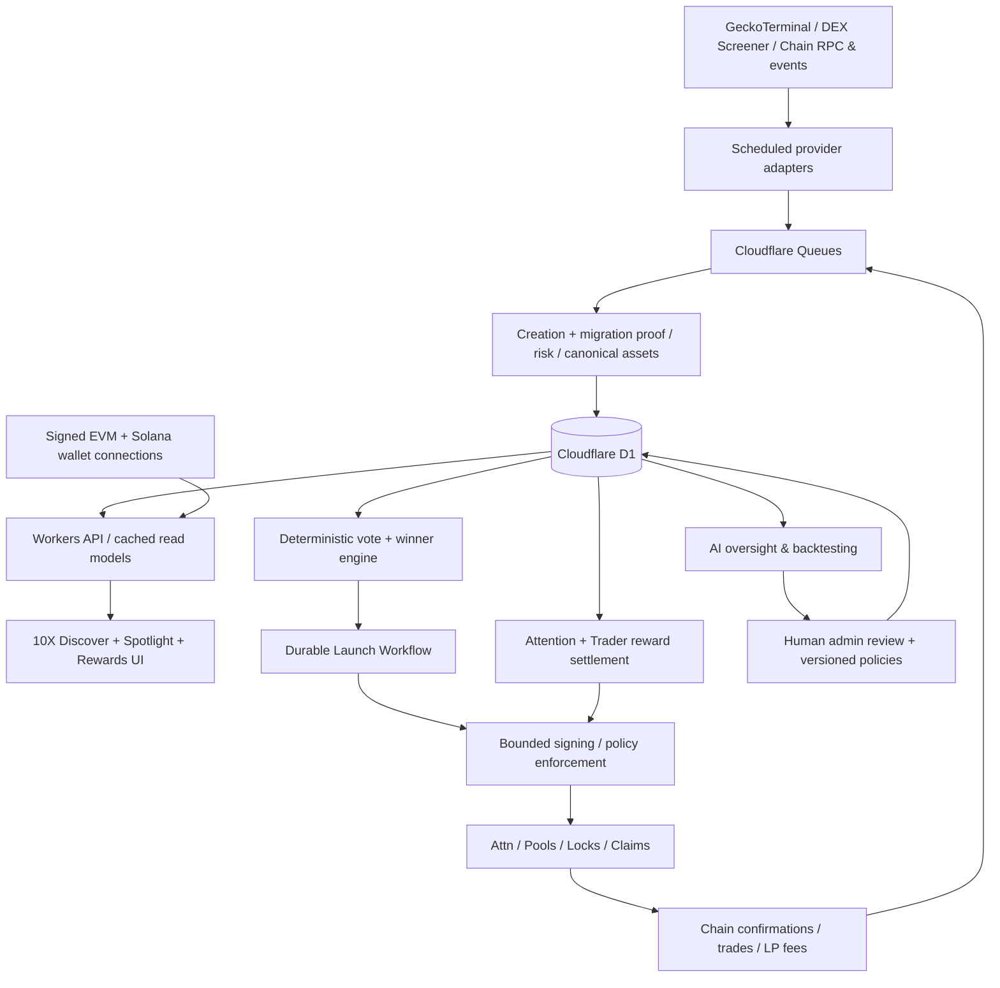

# 10X.MEME — Full Product Requirements Document

**22 October release constraint — decided:** The next production release must keep the old thesis at the App root and hide all unfinished 10X product pages, menu links and APIs behind the closed [exposure feature flag](../88-thesis-only-production-release.md). Migrations may ship without opening the product. Local development continues; evidence, action and provider gates remain unchanged. Production upload checks must verify the actual closed build and server setting. This prepares a future release and does not authorize deployment now.

**Version:** 1.2\
**Date:** 21 October 2026\
**Status:** Product specification for engineering planning; some contract/economic parameters require prototyping and explicit validation\
**Deployment preference:** Cloudflare-first, low recurring infrastructure cost, autonomous/rules-based operation\
**Business:** Code Hunt Pty Ltd trading as 10X Meme\
**Product domain:** `10x.meme` (illustrative routes; retain existing properties as required)

> **Vision:** The migration after the migration. A chain-agnostic discovery and quality-first launchpad that spotlights **at most one** newly graduated OG memecoin at a time, amplifies rather than vampires its community, and rewards the people who bring authentic attention and trading participation.
>
> **Brand thesis:** **We don't VAMP. We AMPlify.**
>
> **Operating principle:** **Autonomous by default, guarded by deterministic rules, verifiable where valuable, with founder and AI oversight rather than founder-dependent daily operation.**

---

## 0. Reading guide and decision status

**v1.2 change:** The founder requested graded discovery on 21 October 2026. Section 4.7 supersedes binary eligibility as the primary browsing/ranking experience. The original v1.1 remains retained. Eligibility thresholds in §§4.3/5 remain action/rehearsal gates; they do not prevent observed tokens appearing in the score-ranked list. No financial execution, deployment or spending is authorized by this revision.

This PRD deliberately differentiates **confirmed product decisions**, **proposed design defaults**, and **items requiring simulation / approval**. Do not treat all examples as immutable product policy.

- **[DECIDED]** Direction established in the product-design discussion.
- **[PROPOSED]** Suggested default, to be approved/adjusted in Admin settings.
- **[VERIFY]** Technical, market-data, compliance or protocol assumption that must be tested with current documentation and end-to-end transactions.
- **[LATER]** Intended capability to architect for without delaying first deployment.

**Not investment advice, an assurance of safety, or a prediction of token returns.** Data filters must never be marketed as preventing all scams. Contract deployments and money-moving automation are disabled until audited/tested/configured with controlled permissions.

### Product decisions captured

1. **[DECIDED]** Multichain discovery across Solana, Base, BNB, and Robinhood Chain (enable chains individually as sources and as launch destinations).
2. **[DECIDED]** Target newly *created in the preceding 24 hours* and genuinely *graduated/migrated* OG tokens, with initial minimum approximately **$100,000 market cap**, plus filters for liquidity, holders and abuse.
3. **[DECIDED]** A capped discovery list of **at most 100 observed candidates**, ranked primarily by a transparent **0–100 Discovery score**, with evidence coverage and risks visible. Fully eligible status is separately required for gated actions. Refresh within source allowances.
   **21 October clarification:** Discovery should find the strongest supported first-day market-attention and momentum wave in the observed inventory. Genuine trailing-24h trading volume and meaningful net holder growth are core scoring requirements, with recent participation and retention supporting the cumulative totals. Wash trading and wallet crop dusting must not manufacture momentum credit. See §4.7 and the [implementation plan](../70-authentic-attention-momentum.md).
4. **[DECIDED]** Genuine OG-token purchases express community preference toward the next spotlight; rank using manipulation-resistant rules, not nominal wallet count or uncapped spending.
5. **[DECIDED]** At most **one active spotlight/attention-token edition at a time**; normally up to one new launch per day, extend the existing spotlight or skip if no qualified winner.
6. **[DECIDED]** Each attention-token launch nominally allocates **50% native-asset pool / 20% OG-token pool / 20% local-chain $10X pool / 10% attention rewards**. The OG and $10X pools are **single-sided initially**, seeded solely with the newly minted ATTN token. The native pool configuration is protocol-dependent and must be separately validated.
7. **[DECIDED]** The **10% ATTN attention reward allocation is distributed over 10 days**, so many campaigns overlap even though there is one current spotlight.
8. **[DECIDED]** People create content on **any platform**, submit URLs to 10X, optionally publish/share a Farcaster cast with an approved signer, gain legitimate upvotes/engagement/referrals and receive ATTN campaign rewards.
9. **[DECIDED]** Warplet NFT level/ownership and verified account actions, ongoing activity and loyalty create **Boost multipliers applied AFTER the raw leaderboard ranking** for attention and chain-specific $10X trader rewards.
10. **[DECIDED]** Each blockchain has its **own independently minted $10X token and supply**, **not bridged** and not fungible with $10X on other chains. A chain's token represents participation in that local 10X economy, not claims to revenue or equity in all chains.
11. **[DECIDED]** Each chain's $10X has **50% public allocation / 50% community reward reserve over 10 years**; no minted founder/team allocation.
12. **[DECIDED]** Platform/founder-controlled business and growth treasury receives **the protocol-permitted creator/LP fee entitlements** from launch pools, including SOL/BNB/ETH/OG/$10X/ATTN depending on AMM. Founder earns from fees rather than selling vested founder tokens.
13. **[DECIDED]** Fee-earned tokens can be held, converted or redeployed into **secondary concentrated-liquidity (CL) positions**, potentially converting volatile inventory to native assets while earning additional fees. Secondary LP is a treasury strategy, **not a guaranteed no-selling or risk-free yield mechanism**.
14. **[DECIDED]** Maximal safe operational autonomy: the app keeps working without the founder checking every day; transparent configurable rules, incident recovery, admin oversight and periodic AI-recommended improvements.

**Still open:** launch AMM details on each chain, precise starting price/ranges of three pools, fee tiers, quote-only feasibility across chains, per-chain $10X public launch mechanism, voting score parameters, boosts, ATTN reward allocation weights, legal review, budget caps, and the exact graduation proof adapter by launchpad.

---

## 1. Executive summary and strategic thesis

### 1.1 What 10X is

**10X Discover** automatically assembles a trustworthy-to-inspect (not guaranteed-safe) global shortlist of newly created, migrated OG memecoins. **10X Vote / Back** measures eligible community conviction through independently verified purchases of OG tokens. **10X Spotlight** selects one winner and launches a structurally linked 10X attention-token edition on the OG's own chain. **10X Attention** runs a 10-day content/referral reward campaign supporting the OG meme. **10X Trader Rewards** distributes each chain's $10X reserve to eligible market participants over the long term. **10X Treasury** earns and manages fee income and liquidity automatically within risk limits.

**Differentiation:** conventional launchpads seek throughput (many launches); 10X seeks curation, scarcity, real community attention, reciprocal OG economic links, and continuity via chain-specific $10X pairings.

### 1.2 What 10X is not

- Not a new general-purpose social network requiring exclusive daily posts.
- Not a guarantee that a token is safe, profitable, or will increase in value.
- Not a multi-chain bridged single $10X asset.
- Not a mandatory new memecoin every calendar day.
- Not a system that automatically rewards wash trading, losses, liquidations or raw trading volume without safeguards.
- Not a promise that every ATTN trade creates net sustainable demand for the OG; swaps and arbitrage are bidirectional.
- Not a substitute for audited smart contracts, market-data provenance or legal analysis.

### 1.3 Primary audiences

**Time-constrained traders:** one useful curated shortlist, key risk indicators and candidate details. **OG meme communities:** access to extra visibility and a reciprocal linked launch. **Content creators / distributors:** earn ATTN by creating useful OG-related external content and bringing genuine attention. **Repeat launchpad traders:** earn chain-specific $10X through bona fide participation. **Founder / operator:** low-cost, low-touch automated operations; clear fee-funded economics and emergency controls.

### 1.4 North-star / health metrics

**22 October delivery correction:** the current phase is an evidence-qualified Discovery MVP, not live launch/reward operations. Track a useful daily shortlist journey, unfamiliar-token source yield/freshness, explicit unknowns, missed successful-runner opportunities, independently reviewed adverse cases/false positives, and affordable storage/read cost. Report functionality delivered, evidence qualified and release ready separately; none implies the others. The commercial/campaign metrics below remain later-phase goals. [Measured progress and revised priorities](../97-prd-design-performance-security-review.md).

- Weekly **retained verified traders** visiting and participating in ≥2 separate campaign cycles.
- **Qualified OG purchases** and distinct attributable market participants, versus comparable unfeatured tokens.
- **Incremental legitimate attention** delivered to OG projects: verified qualified clicks, new unique visitors, social interactions and measured retention.
- **Net realised fee revenue** in native-asset terms after provider costs, gas, rewards and promotions; separate from unrealised token gains.
- **Campaign outcomes:** eligible submissions, legitimate reach, referred unique participants, cost per quality participant, 10-day attention decay curve.
- **Operational autonomy:** automated completion rate, successful recovery rate, unattended days, manual approvals per month, false-positive selection count.
- **Trust:** auditable launches and fee claims, no double airdrops, proportion of rankings with reliable provenance, no unreviewed high-risk deployments.

---

## 2. User journeys and UX

### 2.1 Anonymous visitor

**Current-phase journey:** production remains the thesis-only root with unfinished routes/menu/assets closed. In the authorized local Discovery workspace, browse observed first-day Solana tokens, search an exact mint, inspect grade/coverage/concern and missing daily metrics, compare up to three, and save/reopen a browser-local shortlist. Discovering or saving a token grants no votes, rewards, qualification or study enrollment. Keep search/age/sort/view concise and advanced filters progressive; show the first candidate in the initial viewport after successful loading at 1280×720 and 390×844. Support an appropriately wide desktop table, mobile cards and keyboard/zoom/reflow review against WCAG 2.2 AA. Avoid two-axis nested scrolling where ordinary page layout works. Artwork fallback and exact identity remain mandatory, with no image-based trust credit. The broader journey below remains the intended later product, not a claim of current support.

1. Open 10X → see **Today's Spotlight** and **Tomorrow's Contenders**.
2. Select chain (All / Solana / Base / BNB / Robinhood), age, market cap, volume, liquidity, risk filters.
3. Inspect a candidate: OG token address, chain, original launchpad, actual creation time, confirmed migration event, current verified market metrics, risk indicators, social links and historical snapshots.
4. Follow **Buy OG** deep link to supported trading venue; **do not imply a purchase was counted as a vote without later wallet verification**.
5. Connect wallet(s), agree to rules, see eligible on-chain purchases and vote credit after indexer confirmation.

### 2.2 Spotlight trader

1. Visit current spotlight detail: OG project thesis *attributed as editorial commentary*, direct OG market, ATTN market, pools, liquidity locks, fee policy, anti-sniper method, reward status and contract links.
2. Buy OG or ATTN using external swaps or a later embedded aggregator.
3. See 10X edition historic pool prices and routing details, including potential slippage and fees.
4. Opt into a chain-specific $10X points season; see eligible trading, raw score, raw rank, boosts and eventual claim status.

### 2.3 Content contributor

1. Connect identity; link social proof/account where possible.
2. Create an OG-related post on X, Farcaster, TikTok, YouTube, etc.
3. Paste URL into relevant campaign; metadata is fetched safely or entered manually if embedding blocked; optionally add commentary / category and campaign referral link.
4. Optional opt-in publish or quote-cast to Farcaster via approved signer. Never silently post for the user.
5. Receive community votes and eligible attention/referral metrics, with moderation and anti-fraud status.
6. See **daily raw content rank** then boost multiplier and projected ATTN; claim after period finalises.

### 2.4 Founder / admin

1. Dashboard morning digest: system health, candidate quality, pending launches, campaign activity, fees and liquidity inventory.
2. Configure numeric thresholds and schedules with staged publishing, change previews and rollback.
3. View AI-generated observations, anomalies and proposed settings changes with measured evidence.
4. Approve restricted actions when needed; otherwise leave verified workflows running automatically within pre-approved budgets.
5. Access pause modes, incident logs, key policies and read-only public transparency pages.

### 2.5 Site information architecture

- `/` — Today + shortlist + global chain activity.
- `/discover` — Search, candidate cards, ranked/filterable list, voting window.
- `/token/:chain/:address` — OG profile, evidence, voting, metrics, risk and social links.
- `/spotlight` and `/spotlight/:id` — Active / historical launches, OG & ATTN, pools, lock proofs, campaign status.
- `/attention` and `/campaign/:id` — All active 10-day campaigns and content submissions.
- `/submit` — Link submission and authorship verification.
- `/leaderboards/attention` — Campaign-specific daily scores/ranks.
- `/leaderboards/trading` — Per-chain season points/ranks.
- `/rewards` — Claimable ATTN and $10X, history, boost calculation.
- `/warplets` — Linked NFT, Level, active eligible boosts.
- `/10x/:chain` — Independent $10X token details, addresses, emission, current LP footprint.
- `/transparency` — Published rules, deployments, fee collection, official wallets, risk exceptions.
- `/admin/*` — Restricted operations, policy, telemetry and overrides.
- `/status` — Data freshness, incidents, scheduled jobs, degraded modes.

**Design:** mobile-first responsive. Dark background (#101011), green (#00FF00) accent where useful, simple trading UI; do not let the Matrix/Warplet identity override readability. Token and chain are always visible alongside full copyable addresses and explorers. Distinguish OG / ATTN / chain-specific $10X clearly.

---

## 3. Core operating calendar

Use UTC as system time internally, configure user/admin local time display. Each daily cycle has an explicit timezone, configurable cutoff and transition. Exact times are **[PROPOSED]**; no hardcoded founder timezone.

**At any moment:** up to ~100 eligible shortlisted OG tokens; **one current spotlight**; **up to ten overlapping 10-day attention campaigns** under a one-new-launch-per-day cadence (brief overlaps around exact windows possible). $10X trading reward seasons continue separately.

| Phase | Trigger | Automated action | Safe fallback |
|---|---|---|---|
| Discovery | Every 2–5 min; faster price refresh as budget allows | Get new/selected migrated OGs; dedupe; validate origin & eligibility | Retain last known snapshot, show stale badge |
| Risk scoring | Each candidate update | Apply hard filters, risk penalties, verification | Quarantine uncertain tokens |
| Voting | Continuous until cutoff | Import eligible purchases; recalc deterministic vote scores | Freeze most recent confirmed score |
| Winner selection | Configured daily cutoff | Snapshot immutable inputs; rank; integrity checks | No winner; skip or extend active spotlight |
| Launch preparation | Before scheduled start | Simulate and prepare token, pools, amounts, prices, fee rights | No chain transactions if any guard fails |
| Launch | Scheduled, approved mode | Execute staged on-chain deployment, verify pools and locks | Abort remaining steps, alert, do not falsely announce |
| Spotlight activation | Verified launch complete | Publish campaign page, notifications, onchain links | Remain PREPARING; recover idempotently |
| Content/moderation | Continuous | Accept URL submissions, validate, rank, challenge suspicious activity | Queue for manual review, never auto-award pending items |
| Attention settlement | Daily for each active 10-day campaign | Snapshot raw ranks, apply boosts, enforce daily budget, create claims | Retry without duplicate distribution |
| Trader season settlement | Weekly/30-day season (configurable) | Calculate per-chain rewards, anti-sybil checks, emit claim roots | Extend challenge window; don't issue uncertain rewards |
| Fee harvesting | Scheduled/min amount thresholds | Claim eligible LP fees, record asset receipts | Skip if uneconomic/stale/unsafe |
| Treasury LP | When thresholds and risk policy allow | Make/simulate secondary positions, publish holdings | Hold fee-earned tokens; never force trade |
| Owner oversight | Every 2–3 days | AI-assisted report, proposals, risk/ops trends | Monitoring continues if founder absent |

**Canonical spotlight rule:** No new spotlight while an existing one is designated extended/active; extension can occur if published success conditions pass. Historical attention campaigns continue for ten days regardless of which spotlight is current. Publishing another launch must not reset preceding commitments.

---

## 4. Multichain discovery and data ingestion

### 4.1 Supported scope

**Discovery networks:** Solana, Base, BNB Smart Chain, Robinhood Chain. Enable individually. Future chains through versioned adapters. **Launch support is separately configured**. A discovery-supported chain cannot win until deployment & treasury adapters pass certification; candidates can still be displayed with `launchEligible=false`.

### 4.2 Data sources and cost constraints

Start with **GeckoTerminal Public API** for per-network new/trending pools and pool metadata; use **DEX Screener** for batch price/liquidity/volume/pair data subject to its license, and source-specific onchain events / RPC to validate token age, origin and graduation. Allow public RPC only for low-frequency final verification until paid/managed alternatives are needed.

- GeckoTerminal public API base: `https://api.geckoterminal.com/api/v2`; `GET /networks/{network}/new_pools`, `GET /networks/{network}/trending_pools`. Its current public Swagger contract records approximately 10 calls/min, subject to fluctuation, and one-minute caching; current CoinGecko Demo separately advertises 100 calls/min and 10k credits/month. Do not transfer Demo quotas, fields or licences to the legacy public host. Verify exact endpoint entitlements and keep our lower internal budgets; see the dated [source comparison](../64-free-data-source-comparison.md).
- DEX Screener: `GET /tokens/v1/{chainId}/{tokenAddresses}` batches up to 30 addresses at a documented 300 req/min; profiles/boosts endpoints 60 req/min. **Do not confuse an API's nominal rate limit with unlimited permitted redistribution rights.**
- Provider source priority/rate limits, timeout, error budget and cost in Admin.
- DEX Screener API terms prohibit building directly competing products; whether 10X's intended use is permitted remains a production-use review, not an assumed exemption. GeckoTerminal and CoinGecko Demo have separate access/licence contracts. Keep provider adapters replaceable.
- **Important distinction:** `poolCreatedAt` is **not** evidence that a token itself was created within 24h, and `new_pools` is **not** proof of launchpad graduation. Both conditions require separate provenance.

GMGN Agent API now has an **implemented query-only local integration**, following the founder-requested [evaluation](../63-gmgn-api-evaluation-and-plan.md), supplied query key and explicit storage/display direction recorded in [the integration](../71-gmgn-read-only-integration.md). Retained receipts verify access to the particular info/security/pool/candle/trader/activity endpoints used; this does not establish entitlement to every endpoint. Founder-supplied API Management wording records a $100 minimum balance and hourly asset refresh, so access remains balance-gated Free rather than unconditional no-capital access. Provider rights are not independently confirmed; the founder's use direction is recorded separately and is not a reason to request the same storage permission again. No funding, signing credential, paid fallback or deployment is authorized. Existing source quotas, pause/backoff and independent evidence gates remain. Broad market-list access, effective filters and request weights must be verified before the [next product plan](../82-next-product-functionality-plan.md) activates those new endpoints.

**21 October broader source review:** [Free API comparison and ordered continuation](../64-free-data-source-comparison.md) prioritizes conditional investigation of Jupiter Tokens V2 organic metrics and GeckoTerminal/GT Score/candles alongside GMGN; focused Birdeye Standard candle/holder queries and Helius Free RPC/history are alternatives. Confirm actual Free endpoint entitlements, weighted/monthly budgets and applicable rights before an API experiment. Linked Jupiter terms restrict comparison/sharing/combination and use swap-oriented definitions; Birdeye general terms restrict capture/storage/sharing, with supplemental terms potentially controlling. Neither a Free plan, an agent skill nor a terminal UI establishes retained research/public-display/export permission. No new runtime source or quota is activated.

**21 October implemented preparation:** [Offline Jupiter/GeckoTerminal workbench](../65-source-pilot-workbench.md) supplies bounded fixed-host request descriptors, strict response normalizers, explicit synthetic/unverified provenance, hashed file freeze/replay and a read-only held-state panel. No new source requests, database capture, credential, migration or activation control exists. Actual API-specific rights, Free entitlements, real fixtures, pool binding and atomic shared-budget admission remain prerequisites for collection. This prepares the plan without bypassing its preflight or changing current provider schedules.

**21 October collection foundation:** [Atomic shared admission, bounded transport and public-trade review](../68-source-collection-foundation.md) now prepare individually charged Jupiter and Gecko metadata/candle/trade requests. Pilot attempts share the original 20-inside-600 market and 100-record/10-MB research ceilings with existing cohorts; failures count and incomplete reservations remain charged. Local migration 0041 is additive. The adapter has no runtime/CLI/schedule wiring, so collection stays held for API-specific rights/retention, real Free fixtures and independent canonical binding. Trade samples preserve unknown vendor flags and cannot prove wallet control or wash trading. Connect a predeclared cohort within existing maintenance limits, then prospectively compare current v4 with vendor evidence before any score change. No new source request, credential, quota increase or deployment.

### 4.3 Eligibility hard rules, configurable

These rules govern action readiness and election integrity. Under v1.2 they do not block score-ranked browsing: observations with missing or failed checks remain visible with grades, coverage and concerns.

**Proposed initial filters:**

| Filter | Suggested default | Enforcement |
|---|---|---|
| Token creation age | ≤24h at candidate entry / eligibility snapshot | Verified mint/create event or reliable launchpad origin record; unknown => provisional/excluded |
| Graduation | Graduated to a tradable DEX/AMM from recognised originating launchpad | Onchain migration event or verified launchpad status, not guessed from liquidity |
| Market cap | ≥$100,000 USD | Real market cap when verified; distinguish FDV and missing supply metadata |
| Liquidity | Initial configurable floor e.g. $25K | DEX pool value and depth; exclude fake/inaccessible pools |
| Trading activity | Minimum unique traders / confirmed trades / realistic volume | Avoid circular self-trading; require organic indicators |
| Token permissions | No unacceptable mint/freeze/blacklist/admin drain permissions | Chain/token-standard-specific checks |
| Holder concentration | Threshold on top non-LP/non-custody wallets | Chain-specific analysis, warning for unknown provenance |
| Pool integrity | Known pool factory, reserve validity, acceptable routing | Verify chain state |
| Spam & duplicates | Same asset/bridged wrapping/name impersonation rules | Canonical identity by chain+mint/contract, not symbol |
| Prior participation | Optional cooldown if already spotlighted | Prevent repeat daily recycling |

All filters configurable with `hard_fail`, `risk_penalty`, or `informational` classification. Source freshness and confidence displayed. **The label should be `Eligible / Provisional / Excluded`, not `Scam-free`.**

### 4.4 Discovery pipeline

1. **Harvest** recent pools and launchpad events per chain, track cursors and watermark of scanned time/slot/block.
2. **Canonicalize** chain+contract+origin launchpad+primary pool; merge duplicate pool entries without merging distinct token contracts.
3. **Verify** creation time, migration transaction, circulating supply, DEX liquidity, fee/transfer behaviour and control authorities; attach `provenance[]`.
4. **Enrich** snapshots: market cap, FDV, price, liquidity, 5m/1h/6h/24h volumes, verified buyers/sellers if accessible, holder/insider indicators.
5. **Assess** hard rules and data completeness for action readiness; retain uncertain or missing-critical-information observations in graded discovery with explicit risks/gaps.
6. **Rank** browsing with the versioned Discovery score and evidence coverage in §4.7. Paid boosts/ads are not ranking positives.
7. **Publish** up to configured max (100); cache public read models and maintain a last-updated indicator.
8. **Expire** from new-candidate voting when outside the window while retaining history, especially selected winners.

### 4.5 Refresh strategy (free-first)

Proposed budgets: GeckoTerminal **≤8 req/min total across networks initially**; DEX Screener after permissions **batched candidate pricing** (≤4 calls to refresh ~100 addresses per chain partition, plus details only on demand); indexer/event source on less frequent cycle. Show prices approximately every 60 sec *where rate limits allow*; discover new entrants every 2–5 mins. Strongly cache results, consolidate per-network requests, stagger cycles, exponential backoff on 429 and errors. No browser should directly hammer providers.

Use one central scheduler and shared cached data across all visitors. Daily source and cost metrics must prevent accidental API overspend. If provider terms prevent operation, disable that adapter and allow verified chain-event-first ingestion or alternative licensed market data.

### 4.6 Verified graduation adapters

Create interface `GraduationVerifier`: `{ chain, launchpadId, mintedAt, graduateAt, graduateTx, marketAddress, status, proof, confidence }`. Implement known Solana launchpad adapters first (Pump→PumpSwap where verifiable); then add supported Base/BNB/Robinhood launchpads. For unknown launches, label **unverified**, do not silently treat every new market as a migration. Indexer can reconcile late events/chain reorganisations; recompute if rollback occurs.

### 4.7 Graded discovery — v1.2 founder direction and implementation plan

**22 October bounded-inventory checkpoint:** [98 — current evaluation and retained directory](../98-current-inventory-and-retained-directory.md) separates explicit active-inventory scoring from indexed unranked historical identity browsing. `/history` retains exact-mint/evidence access beyond 500 total identities; Discover's current 500-input/4 MB evaluator guard remains, including active-overflow holds. Existing v4 and old source/cohort/election replay are unchanged. Fixtures cover 501/1,000/5,000 identities; no live migration, new provider work, policy/gate adoption, restart or deploy. This is the first capacity slice; raw-store/Free-hosting feasibility, durable compact read models and dependency remediation remain open. Production stays thesis-only, including the new namespace.

**22 October cross-cutting review — current priority:** [97 — progress/design/performance/security](../97-prd-design-performance-security-review.md) records core F2 delivery, partial F1/F3/F5 and unvalidated F4. The measured 486-token retained inventory approaches the existing 500-input guard, while the 1.07 GB local store cannot fit one D1 Free database. Prioritize a versioned bounded current index plus preserved historical lookup, affordable precomputed read models and dependency remediation alongside ordinary admitted collection. Keep current 500-candidate/4 MB evaluation bounds until a tested design replaces whole-history coupling; no silent trimming, evidence eviction, quota reset or paid fallback. Improve first-result visibility and table layout. Current v4 stays live until a separately preregistered paired holdout supports a change; unknown weights are never renormalized and reported volume/raw owners never become qualified daily attention.

**22 October measured-coverage checkpoint:** [Retained activity census](../96-retained-activity-coverage-audit.md) adds private read-only export and checksum replay over every retained token and all thirteen activity metrics. The 484-token snapshot separates 482 coverage-population tokens from two regression references; the former had no saved GMGN info/candle fields. Missingness, staleness and unqualified daily metrics remain explicit. This is a retrospective coverage audit, not prospective study enrollment or approval of new scoring weights. Continue admitted broad collection and F3 qualification; v4, all Free/evidence/action gates and thesis-only production remain. No source request, database mutation, migration, restart or deploy.

**22 October persistent restart checkpoint:** [Durable supervisor allowance](../95-durable-supervisor-restart-budget.md) preserves three launcher starts per fifteen minutes across supervisor ownership changes. Committed reservations precede spawn; saved debt/first adoption use conservative monotonic cooldowns and invalid/orphan state holds. Forty-five recovery tests pass, with no forced live restart, quota/research change, scoring/gate adoption or deploy. Activation is at the next ordinary supervisor start; wider F5 reliability remains open and production stays thesis-only.

**22 October pagination checkpoint:** [Discovery snapshot pagination](../94-discovery-snapshot-pagination.md) exposes existing retained observations beyond the first hundred, with 100-token pages, one scoring cutoff, cached navigation and fail-closed refresh recovery when data changes or cursors expire. The existing 500-candidate source bound and legacy top-100 API default remain. No source collection, database mutation, score/study adoption, quota/gate change or deploy; production stays thesis-only.

**22 October recovery checkpoint:** [Local supervisor vacancy recovery](../93-supervisor-vacancy-recovery.md) fixes recovery after an unowned local service disappears, while refusing occupied-port starts, retaining active ownership and preserving three starts per fifteen minutes. Fault tests use isolated ports/subprocesses; no live restart, quota reset, source change, scoring/gate adoption or deployment occurs. The engine loads on the next ordinary supervisor start. Wider runtime reliability and the underlying Wrangler transport issue remain open; production stays thesis-only.

**22 October saved-workspace checkpoint:** [Browser-local shortlist](../92-browser-local-discovery-shortlist.md) adds exact-mint Save for later on cards/table/details and a persistent local list with evidence links/comparison outside current results. Live/examples are isolated, storage failures are explicit and no scores or observations are persisted. Saving has no source-collection, study, voting, eligibility or reward effect; frozen v4, all evidence gates, Free limits and thesis-only production closure remain unchanged.

**22 October storage-recovery checkpoint:** [Local evidence archive and verified restore](../91-local-evidence-archive-and-restore.md) adds private complete-store SQLite snapshots, pinned checksums, measured row/page inventories and restoration into a separate verified scratch file. Historical evidence, quotas and identities are preserved; there is no deletion, counter reset or runtime activation. Multi-day growth, approved retention and operational adoption remain open. Frozen v4, every evidence/action gate, provider Free limits and thesis-only production closure remain unchanged.

**22 October trading-sample checkpoint:** [Recent signed trade samples](../90-signed-trading-sample.md) add dated sampled buyers/sellers, exact SOL/WSOL protocol quote totals and equal-known-size/buy-sell overlap measurements to comparison. Unknown quotes/finality, stale sources and short young-token windows remain explicit. No population, organic-demand, wash verdict or scoring credit is inferred; frozen v4, all evidence/action gates and thesis-only production closure remain.

**22 October coverage checkpoint:** [Broad rotation coverage](../89-broad-rotation-coverage.md) tracks selected/new mints, endpoint gaps and operational collection states over fourteen UTC days using cached manifests/metadata only. Counts do not establish receipt validity, organic activity, the broad-cohort quality target or scoring promotion. V4, all evidence/action gates and the thesis-only production release flag remain unchanged.

**21 October founder counterexample correction:** [Kimchi positive-runner reference](../87-kimchi-positive-counterexample.md) retires the standalone $10M-within-24h warning. Rapid valuation growth alone does not distinguish manipulation; concentrated strategic/KOL allocations may coexist with successful attention. Keep performance, ownership/control, acquisition/retention and integrity labels separate. Require comparable successful/failing controls and false-positive review in F4; founder-selected historical examples never become unseen holdout or safe/organic ground truth. Frozen v4 and all action/evidence gates remain; no token-specific exemption or deploy.

**21 October F3 holder-participation slice:** [acquired and retained samples](../86-acquired-retained-holder-sample.md) introduces fixed experimental 0.01 SOL / 30-minute sample checks over full owner inventories and archived signed buys, with endpoint-balance consistency and observed creator/link screening. Cache-only comparison exposes actual intervals, disjoint classifications and source holds. These are bounded samples, not qualified 24h growth, beneficial independence, organic demand or fraud labels. Current v4 and every Free/evidence/action gate remain; no new collection, migration or deploy.

**21 October F3 recent-activity slice:** [recent candle measurements](../85-recent-candle-activity.md) adds fixed-policy closed 5m/1h/6h windows and same-duration prior-period volume ratios to cached comparison. Missing minute/flow evidence, zero baselines, stale/future sources, receipt skew and pre-creation windows retain explicit holds. Reported candle activity does not qualify organic volume, trader breadth, meaningful holder growth or attention credit. Current v4, all gates and Free budgets remain; no collection change or deploy.

**21 October F1/F2 continuation:** [common activity and three-token comparison](../84-common-activity-and-token-comparison.md) implements dated token/pool/wallet observations with explicit units, windows, denominators, source references and qualification, plus cached comparison at a shared current-v4 cutoff. Source scopes and missing/rejected evidence stay distinct; organic volume, meaningful daily growth and attention momentum remain held. Core daily browsing/comparison is implemented. Admitted broad-cohort observation, preregistered F3 metrics, prospective F4 scoring and F5 reliability remain open. No new provider collection, gate waiver or deploy.

**21 October first F1/F2 delivery:** [rotating coverage and discovery workspace](../83-rotating-coverage-and-discovery-workspace.md) implements immutable daily selection from the active chain inventory and searchable cached cards/table with coverage, freshness and liquidity filters. The old recurring regression cohort is replaced within the same scheduled baseline. This is a partial delivery: common dated activity normalization, admitted live broad-cohort observations, three-token comparison and qualified metrics remain open. Current v4 and every evidence/action/election gate remain; local migration only, no deploy.

**21 October next product plan — proposed implementation order:** [F1–F5](../82-next-product-functionality-plan.md) prioritize a useful cross-token daily discovery product: common dated activity records and rotating coverage; table/search/comparison; meaningful volume/holder growth/recent momentum; a frozen v4/provider-derived/hybrid comparison on unseen mints; and local reliability/archive readiness. Founder concern cases remain regression fixtures, not the primary validation sample. Reuse supported provider intelligence instead of building an exhaustive wallet index. Keep v4 live until a prospective versioned improvement is supported, preserve missing evidence and dominant risk concerns, and never let discovery rank bypass voting/launch rules. Start with F1 and the first F2 slice. Recommended browser-local saved shortlists are a small optional UX extension, not a previously confirmed requirement. This planning revision activates no collection, score, financial flow or deployment.

**21 October quote-basis foundation:** [Saved SOL transfer and fee review](../81-gmgn-quote-and-fee-basis.md) replays the complete source/RPC comparison and measures canonical quote transfers with exact raw integers. Keep event quote, pool transfer, LP/protocol/creator fees and wallet swap cash flow distinct; protocol buyback is counted once. Unknown fee extensions or incomplete rows withhold wallet totals. Provider USD divided by pool-transfer SOL is an explicitly labelled implied conversion, not an independent historical price, certified USD or organic/daily volume. Cache-only UI/export/replay makes no provider call, database write or collection/allowance change. Preserve archived reports, current v4 and every evidence/action/election gate. No deploy.

**21 October RPC corroboration foundation:** [Source-bound event comparison](../80-gmgn-rpc-corroboration.md) permits one explicit journalled investigation of at most two signatures from a fully replayed accepted GMGN activity/selection source. Use existing wallet leases, pacing, pause/backoff and shared RPC quotas; at most one genesis plus two finalized transaction reads, with no arbitrary scope, scheduler expansion or blind retry. Cache-only reports compare selected-wallet signer, side, block second and exact raw instruction quantities; distinguish aggregate-only equality, conflicts, parser holds and missing bodies. RPC body consistency is not independent finality, historical USD, counterpart independence or organic/daily volume. Preserve old hashes, current v4 and every evidence/action/election gate. No deploy.

**21 October wallet-activity foundation:** [Source-bound token-filtered events](../79-gmgn-wallet-activity.md) investigate the largest complete regular-wallet flow in a retained trader sample through one fixed twenty-event query. Require the original source hash, deterministic selection, exact token, valid signature syntax and dated event types. Separate transfers, unknown/invalid/signed USD and same-second ordering; hold affected totals rather than invent volume. Report repeated exact same-side sizes and both-side signatures as descriptive cues, not wash verdicts. Cache-only UI and private two-receipt replay add no scheduled pilot or provider allowance. Independent chain/scope verification, organic/daily qualification and prospective score adoption stay held; preserve current v4, old hashes and all evidence/action/election gates. No deploy.

**21 October trader-participation foundation:** [A fixed GMGN top-100 trader query](../78-gmgn-trader-participation.md) adds reported buy/sell USD, concentration, two-sided smaller-leg amounts and transaction counts with separate complete-row denominators. Exclude provider-labelled pool/exchange and unknown account types; reject malformed/duplicate rows and preserve missing-versus-zero semantics. The ranked aggregate period is unknown: it cannot become 24h volume, candle corroboration, acquisition proof or a wash verdict. Keep population coverage, beneficial independence and canonical scope unknown; all qualification/scoring credit remains held. Operator-only collection uses existing shared Free admission/pacing/backoff, with no scheduled pilot expansion. Cache-only UI and private receipt/report replay preserve current v4, archives and every evidence/action/election gate. No deploy.

**21 October cached acquisition foundation:** [Match raw holder entrants to saved signed swaps](../77-holder-acquisition-evidence.md) with exact canonical scope, interval slots/times, finalized signature-history consistency, positive quote/net acquisition, no sampled sells and sufficient endpoint balances. Count transaction-wide net flow once per signature; expose exclusions and unmatched entrants as unknown. Latest-receipt conflicts, missing/truncated evidence and held owner inventories cannot earn support. This finite cached sample establishes neither meaningful growth nor organic/independent demand; all qualification and scoring credit remain held pending economic rules, coverage and prospective validation. Preserve old report hashes, current v4, all provider/evidence/action/election gates and zero new source calls/writes. No deploy.

**21 October cached holder-history foundation:** [Replay full saved owner inventories](../76-cached-holder-growth.md), aggregate token accounts by owner and exclude the exact canonical vault. Publish raw entrants, exits, net change and endpoint retention over actual observed snapshot intervals, with zero/missing baselines, stale evidence, conflicts and incomplete layouts handled explicitly. Bound selection/work and freeze private inputs for offline replay. All acquisition provenance and meaningful/24h/since-creation growth remain unknown until independently qualified; positive dust balances earn no authentic-demand points. This cache-only view adds no source call, collection schedule, database record or score revision. Preserve archived hashes, current v4 and all provider/evidence/action/election gates. Prospective acquisition rules, storage policy and attention calibration remain open. No deploy.

**21 October full-window GMGN continuation:** [Four bounded Free candle queries and reproducible volume-unit checks](../75-gmgn-candle-coverage-and-units.md) cover a declared six-hour window with forty minutes of overlap for consistency. Verify every receipt, reject parent identity conflicts, count matching overlap once and preserve missing/conflicting minutes. USD/token mapping requires at least twelve positive-flow candles unanimously consistent with one price orientation and not its reverse, within 1% OHLC tolerance; absent/ambiguous units stay unknown. Label this as same-provider arithmetic corroboration, not independent trade proof. Full-window USD turnover requires 360 consecutive closed minutes across four successful parts. Live USDF has 360/360 and triggers a fourteen-rise review; PONYX has 328/360 and remains incomplete. Preserve all provider budgets, pacing/backoff, local-calibration boundaries, current v4 and evidence/action/election gates. Independent trade/canonical scope, calibrated wash features and qualified 24h attention remain open; no deploy.

**21 October founder-authorized local calibration:** [Disable internal daily record/byte admission and the research-source HTTP subset during local calibration](../74-local-calibration-admission.md), while keeping provider Free budgets/rate limits, response/record bounds, pacing/backoff, evidence/action/election gates and current score-v4 unchanged. Require explicit local-only plus calibration configuration; missing/non-local configuration stays bounded. Preserve all counters and historical artifacts. Restore bounded research admission before production; no deploy or new financial authority.

**21 October GMGN candle follow-up:** [Correct response-contract mismatches and surface descriptive pattern review](../73-gmgn-candle-contract-and-review.md) within existing admission. Support explicit second/millisecond normalization and missing turnover; withhold ambiguous USD/token units. Show coverage, adjacent jumps, uninterrupted rising runs and alternating bodies with uncalibrated review triggers, never a candle-only wash verdict or organic-volume credit. Preserve archived replay, current score-v4 and all evidence/action/election gates; new live verification waits for actual capacity. No additional allowance or deploy.

**21 October founder-authorized research capacity:** Raise only our shared internal record-admission maximum from 100 to **120 per UTC day** so GMGN can be tested now. Keep the **10 MB** byte limit, twenty source attempts inside existing market limits, per-pass capture/finalization bounds, pacing, provider backoff and every evidence/action/election gate. The [first live checks](../72-gmgn-live-test-capacity.md) verify info/security access; absent risk fields remain unknown and a rejected candle response remains withheld. Earlier 100-record references describe the superseded internal checkpoint, not a provider quota. No resets, historical replacement, paid fallback, scoring change or deploy.

**21 October founder priority — authentic daily attention:** The daily discovery objective is to identify a newly created, genuinely migrated OG token with strong genuine market attention and momentum, so a future authorized ATTN spotlight can build on its first-day wave. Make **qualified trailing-24h USD volume** and **meaningful net holder growth** core inputs in the next evidence-backed scoring revision. Raw reported volume and increases in positive-balance wallets are context, not proof of organic demand. Known wash or coordinated self-trading activity and unsolicited dust recipients cannot earn authentic-participation credit. Unknown wallet relationships remain explicit rather than assumed independent.

For tokens younger than 24h, report the actual since-creation portion of the trailing window and observed coverage; never extrapolate to a fictional full day or substitute migration time for creation time. Holder growth needs comparable, dated owner inventories and acquisition/retention evidence: show absolute net change, percentage only with a valid nonzero baseline, economic-balance rules and sampling gaps. A missing baseline stays unknown. Positive dust balances, token-account creation and provider net-buyer counts are not meaningful-holder growth.

Recent 5m/1h qualified activity, participant breadth and retained holders should distinguish an active wave from a stale 24h total. Publish risk/evidence and attention contributions separately; risk ceilings dominate the final grade, and score sorting never overrides voting or launch authority. Compare only declared windows and scopes; token-wide and pool volume must not be added or treated as identical. Provider-labelled organic metrics remain attributed estimates, not certified organic trading.

**Implementation status:** Current v4 still rewards non-vault positive-balance owner count and bounded sampled price returns; it has no qualified-volume or holder-growth component. The offline Jupiter workbench can parse provider-reported organic windows, but collection/adoption is held and no dust-resistant owner-growth time series exists. Preserve v1–v4 artifacts and all source/action/election gates. The [ordered plan and acceptance cases](../70-authentic-attention-momentum.md) require permitted Free receipts, comparable owner history, declared exclusions and prospective calibration before proposing new weights and activating a new version. This requirement is recorded now; it does not claim those metrics are already implemented.

**21 October founder priority — artwork is critical:** Display actual token artwork prominently on cards and details. Prioritize missing-image recovery inside existing free metadata/market allowances, with exact creation-linked provenance and bounded safe source fallbacks. Keep cached images through list updates and distinguish a pending cache lookup from a confirmed unavailable image. Never invent replacement art, treat an image as proof of authenticity or alter score/action gates merely to improve image coverage. [Implemented recovery and remaining source gaps](../69-artwork-recovery.md).

**[DECIDED]** Discovery browsing uses a continuous 0–100 score, highest first, across observed tokens regardless of binary eligibility. Unknowns and failed checks remain inspectable. The initial view remains verified creations within the last 24 hours, with retained-history filtering available. The score does not override the 24h scope, evidence gates, community voting outcome or launch authority. At most 100 cards; rank the whole bounded inventory before taking that limit. Optional liquidity sorting and explicit action-check filters remain secondary.

Call it **Discovery score**, not a safety probability or a scam detector. **100** means maximum support under this version's measured criteria, not trustworthiness guaranteed; **0** can reflect missing evidence or severe observed failures and must never automatically label a token a scam/rug. Show **effective evidence coverage / 100** beside the score. A well-observed poor token and an unobserved token must have different explanations. Provider prices, sampled funding and holder observations do not establish organic trading, beneficial control, safe exits or future returns.

**[PROPOSED local scoring v1]** Fixed, published weights sum to 100; do not renormalize over available fields:

| Component | Points | Graded inputs |
|---|---:|---|
| Verified origin | 10 | Separate finalized creation 6 and graduation 4; future/contradictory origin evidence earns no credit |
| Onchain controls | 15 | Revoked mint authority 6, revoked freeze authority 4, verified pool reserves 5 |
| Market | 20 | Reported cap up to the $100K target 5, liquidity up to $25K 10, liquidity/reported-cap ratio up to 5% 5; FDV never substitutes for cap |
| Holders | 25 | Owner count up to 100 earns 5; largest owner 8, top ten 8, creation-user holdings 4, with continuous degradation above the current 10/35/5% reference thresholds |
| Wallet/funding sample | 25 | Signed creation wallet 5, up to three verified buyers 5, examined pre-buy funding windows 10, measured dev-funded/sold exposure 5; unavailable/incomplete evidence cannot imply clean exposure |
| Sampled performance | 5 | Same-source positive-price observations spanning at least 30 minutes within a bounded two-hour window; at least six samples, no gap over 30 minutes; sampled return from -25% to +25% maps to 0–5, flat to 2.5. This small weight limits chasing reported price rises; missing history earns no credit |

For healthy limits, quality is 1 through the reference threshold and declines linearly to zero at 100% exposure. For quantity targets, quality is `clamp(value/target,0,1)`. Effective coverage counts known inputs, including known failures, rather than rewarding only passes. Missing inputs earn zero points and zero coverage; they are reported as unknown. Positive support and effective coverage decay linearly after the current freshness TTL, reaching zero at four times TTL. Future observations earn no support. Immutable origin proofs do not expire merely because they were fetched earlier.

Funding-window credit uses unique, examined expected wallets divided by the declared sample's expected wallet count. Explicit omitted-wallet/output-limit gaps make that denominator unknown and withhold funding credit and positive clean-funding exposure credit. Missing/uncertified trade samples cannot earn buyer or clean-sale credit. These are constraints on the affected score components, not a binary exclusion from discovery.

Publish all observed-risk ceilings: rejected/contradictory origin caps at 0; active mint/freeze authority caps at 40; reported liquidity below $25K caps continuously at `100 × clamp(liquidity/25000,0,1)` (zero liquidity caps at 0; missing liquidity remains unknown, not a zero-liquidity finding); largest-owner or creator exposure above its reference caps continuously from 100 toward 10 at 100%; top-ten exposure caps toward 30; dev-funded or sampled dev-sold exposure caps toward 20. Apply the lowest ceiling after summing earned points. Retain dated adverse observations as concerns/ceilings even when stale; partial inventories can demonstrate a failure but cannot earn verified-holder health credit. V1 has no extra penalty for unvalidated cap/linearity warnings. Paid boosts, token names/artwork and unproven common-wallet accusations never change the grade. The founder-authorized XTO review adds a separately versioned v2 policy below.

**21 October XTO review — discovery-score-v2:** Following the founder’s request, current discovery adds provisional, explainable market-integrity checks. A doubling or halving across consecutive valid same-source prices no more than ten minutes apart caps at 40; cached history covers at most 24h / 256 prices per mint and 16,000 projected prices in aggregate, with gaps/truncation explicit. Relative reported depth caps at `100 × sqrt(min(1, liquidity / reported cap / 0.05))`; absent cap/depth stays unknown and FDV is not substituted. Excluding the creation buy, at least five known-quote later trades across at least three wallets, with at least 80% at or below 0.001 SOL each, cap at 40. Only wallets with at least 0.01 SOL of later sampled buys earn buyer-participation credit. New concerns withhold momentum points. Apply the lowest ceiling, retain observation dates and show concerns on cards and details. These are conservative sample-based review rules, not a proven scam/wash-trading classifier; independent calibration remains required. Preserve v1 replay and its explicitly labelled outcome study; prospective v2 retention is now implemented separately from archived v1 (see below). See [evidence, implementation and validation](../60-market-integrity-score.md).

**21 October USDF review — discovery-score-v3:** Add provisional historical-launch and sampled-staircase concerns while retaining every v1/v2 evaluator/export and action gate. A certified signed creator’s positive net acquisition in the exact creation signature/slot/program/time is bounded by known buys, with duplicate/inconsistent trades rejected. Compare with later verified observed supply, publishing both dates and raw quantities; unknown/partial/future/burn-contradictory supply stays unknown. Above 10%, the continuous ceiling declines linearly from 100 to 20 at 80%, then remains 20. This is historical acquisition relative to a later denominator, not initial supply reconstruction or current beneficial ownership.

A quiet staircase requires at least 60 same-source price observations over six hours, gaps at most ten minutes, return at least 10%, sampled drawdown at most 2%, at least two upward steps of at least 3% whose per-minute rates exceed ten times the median absolute rate, and jump log returns at least half the net log return. It caps at 50. Reject incomplete/truncated runs, invalid/future prices and duplicate times; no OHLC or wash-trading verdict is inferred. Freeze the earliest retained market projection separately (at most one row per bounded mint): reported cap at least $5M within ten minutes of verified creation caps at 60. Later first quotes leave opening valuation unknown; no FDV substitution. New concerns withhold momentum and use the lowest ceiling. USDF’s identical saved inputs change from 54 under v2 to 20 under v3; missing actual opening evidence remains explicit. See [review, thresholds and validation](../62-usdf-launch-and-staircase-review.md).

**21 October PONYX review — discovery-score-v4:** Add conservative launch-timing concerns using the existing verified Pump creation/graduation proofs. Both events must be available at cutoff, have recognized instructions/programs and valid fetch/chain times, and be consistently ordered. The same finalized slot with matching block time caps at 50. Combined with the existing report of at least $5M within ten minutes of verified creation, it caps at 25. Different slots sharing a rounded second do not qualify; missing/future/contradictory context remains unknown. Use the lowest ceiling, withhold momentum and show both slots, dates and provider-report limitations. This is not a shared-bundle, original-purchase, initial-market-cap or wash-trading finding. Thresholds are provisional; preserve v1–v3 artifacts, independent action/election evidence, all shared source/research budgets and archived model views. Identical frozen PONYX inputs change from v3 60 to v4 25. [Implementation and remaining validation](../67-ponyx-launch-timing-review.md).

**21 October GMGN integration — founder-authorized continuation:** The founder supplied a query key and explicitly instructed proceeding with the storage/display needed by the app. The [bounded integration](../71-gmgn-read-only-integration.md) now supports exact Solana token info, security, pool and closed-minute candles, sanitized private replay and cached public evidence. Key presence does not establish account access, organic activity or data completeness. Provider licensing is not independently confirmed; the founder's use direction is recorded separately. No signing credential is used. A fixed PONYX/USDF/Kimchi investigation allocates at most one of the existing three capture slots inside maintenance and shared source/research/storage quotas; full admission holds before IO. Current v4 remains unchanged, and real admitted fixtures, canonical binding, independent controls and prospective comparisons remain required before provider-based score adoption. Existing Jupiter/GeckoTerminal holds are unaffected. The earlier evaluation below is historical context, not a request to ask the same storage permission again.

**21 October GMGN evaluation — proposed research continuation:** Trial richer candles, wallet labels, manipulation indicators and creator history as dated third-party observations. The original vendor plan pins custom v3; the independent PONYX launch-timing correction makes v4 current. Preregister the exact custom baseline before any provider comparison and retain the earlier pinned comparators. Compare (A) the frozen custom baseline, (B) a deterministic reproduction of the pinned GMGN due-diligence skill and (C) a preregistered hybrid on the same prospective cutoff. Benchmark the complete vendor candidate-screening workflow separately, preserving its different age/liquidity scope and excluded cases. Vendor heuristic scores are not a single guaranteed per-mint API score; a chart-strength score and `rug_ratio` are not our Discovery score. Do not invert risk labels into a safety percentage, renormalize our missing-data denominator or let provider summaries satisfy independent on-chain evidence gates.

Broaden this investigation using the [Free-source plan](../64-free-data-source-comparison.md): compare Jupiter's organic-activity construct and GT Score as separately labelled baselines after their access/rights preflight, then selected GMGN/Birdeye observations. Do not equate provider organic/trust/chart scores with scam probabilities, cancel independently observed adverse evidence or multiply research arms beyond capacity. Stage experiments within the same source, record and maintenance allowances; choose a new version only after time-separated evidence supports it.

The [G0–G4 plan](../63-gmgn-api-evaluation-and-plan.md) requires verified Free access/rights, authenticated schema fixtures, strict timestamp/unit/identity normalization, bounded cache-only publication, recorded source hashes and chronological validation before any provider-based scoring adoption. V4 above uses existing cached chain/market evidence and does not complete that provider preflight. Existing collection schedules are unchanged. Research comparisons share the original aggregate 100-record / 10 MB admission and three-capture/five-finalization maintenance limits; additional comparison records count too. Existing v1–v3 artifacts and action/election inputs stay immutable. Provider downtime or missing/default-zero labels do not become clean evidence. No paid fallback, trading, launches or deployment.

The [combined activity review](../66-source-activity-review.md) now retains the complete selected inventory, checks supplied pool metadata and measures organic-volume fractions and adjacent candle activity without a new score or wash-trading verdict. Missing/rejected sources remain in the denominator; file metadata is not independent canonical-pool proof. GT score time stays unknown, capture timestamps do not establish synchronized measurement, and token-wide activity is not a pool-volume comparator. Authenticated fixtures, access/rights, atomic admission and matched prospective custom-v3 validation remain required.

The [implemented offline source workbench](../65-source-pilot-workbench.md) keeps all provider results outside current scoring and prospective cohorts. A parsed response or verified local replay does not authenticate a provider, establish organic trading or satisfy chain/action gates. Closed candle gaps remain explicit; opening cap stays unknown. The offline workbench changes no scores; current v4 and all earlier score artifacts retain their own immutable rules.

**Implementation sequence (authorized local work):**

1. Version a deterministic, pure scoring engine and strict scorecard schemas; publish rules/weights/limitations. Freeze candidate, bounded price inputs, observation time and exact scoring policy; hash and replay exported scorecards offline without providers. Preserve old election/cohort schemas and engines.
2. Compute from cached observations only. Bound inventory, price samples and payload sizes; do not make per-card provider requests or change collection priorities, quotas, pause/backoff or financial capabilities.
3. Default Discover sorting to score descending, effective coverage descending, fresh reported liquidity descending, verified creation ascending, canonical address ASCII ascending. Rank before limiting/pagination; encode sort in cursor identity. Display a separate discovery rank without rewriting action/election ranks.
4. Show score/coverage on cards and a component/unknown/staleness/risk-ceiling breakdown on detail pages, with version, as-of time and exact scorecard export. Move binary eligibility into supporting action-check context. Displaying useful ranked tokens no longer requires reaching ten fully eligible tokens; that count remains an operational diagnostic for future gated actions.
5. Test monotonic criteria, unknown-versus-bad evidence, stale/future inputs, partial holder/funding samples, risk dominance over momentum, stable tie ordering, top-100 boundaries, tamper rejection and unchanged historical replay. Validate the existing preview, update progress docs, commit/push. **No deploy.**

Weights are transparent initial heuristics, not backtested fraud/return probabilities. Preserve score versions and assess later outcome cohorts before changing/calibrating weights. Production market-data permissions and financial policy approval remain open. No online self-training or automatic scoring-policy activation.

Prospective evaluation retains each mint/model's first captured score, effective coverage, independent action status and exact replayable inputs, without reconstructing past grades. Compare a fresh baseline with a same-source 24h price/liquidity endpoint after the full two-hour collection grace; preserve missing outcomes and selection bias. Descriptive score-band counts alone do not validate calibration. The bounded cached implementation and remaining validation work are recorded in [prospective score research](../58-score-outcome-research.md).

[Model-separated research](../61-versioned-score-research.md) (local migrations 0038/0039) captures new first grades under v4 at their actual observation time after local migration 0040, finishes existing v1/v2/v3 outcome windows, and never replaces older observations. Score bands and replay links are pinned to their model; legacy unqualified HTTP reads remain v1. All studies share the original total maintenance/storage limits, and follow-up deduplicates mints across versions within five existing spare slots. No historical grades are reconstructed; differently timed captures are not matched validation pairs. Mature independent validation remains open.

Creation-age expiry must not itself prevent pending score endpoint observation. [Bounded follow-up](../59-score-endpoint-followup.md) may use spare targets in existing market batches during the endpoint window, under unchanged source allowances and pacing. Such observations append research history only; they never refresh an expired candidate, restore eligibility or replace frozen inputs/outcomes. Unknown baselines, incompatible sources and unavailable endpoints remain explicit holds.

The founder's 21 October clarification makes qualified 24h volume and meaningful holder growth the next scoring priority, rather than optional distant research. Sustained net unique demand, volume relative to chain baseline and bounded price volatility remain supporting research inputs. These are not certified or scored by current v4; add them only through an explicit evidence-backed model revision. Display scores **must not secretly override the documented voting outcome**, other than stated minimum action eligibility. Save score inputs and model/rules version for later audit.

---

## 5. Voting: back tomorrow's OG

### 5.1 Intended user behaviour

Buying an OG from the shortlist expresses conviction. The UX must distinguish "Buy OG" (external swap), "Eligible verified trade", and "Vote credit calculated". A click on the outbound link is **not a vote**. Wallet connect is required for trade credit; users can link multiple addresses by signature, including distinct EVM and Solana wallets. Track supported confirmed transactions within the election window; ignore unrelated old holdings unless explicit snapshot mode is introduced.

### 5.2 Vote calculation [PROPOSED]

Initial approach: wallet-specific, **net eligible purchases** of candidate OG during contest window, valued in USD using bounded observed spot/TWAP snapshots; logarithmic or square-root weighting to reduce whale dominance, daily per-identity caps, minimal trade size, anti-round-trip, minimum confirmation, funding-cluster/sybil checks, excludes wash-pattern trades. Potential score `sqrt(min(max(verified_net_buy_usd,0), per_identity_cap_usd))` combined with independent distinct genuine buyer / healthy demand constraints. Display score method publicly but withhold exploit-sensitive detection thresholds.

**Manipulation warning:** If votes alter selection of a launch that may create speculative price movements, anti-manipulation controls and restrictions are core system requirements. Do not reward traders for artificial self-trading, and do not create incentive for buying solely to trigger a winner artificially. Legal review before live incentives.

### 5.3 Cutoff / outcome

At cutoff freeze data through a predetermined finality depth and source watermark. Recompute scores using immutable input snapshot and algorithm version. Evaluate top candidate against safety gates and concentration threshold. If suspicious, advance to next candidate or skip according to transparent rules and publish a reason category. Deterministic tie-breaker: higher eligibility quality score, then earlier qualifying entry timestamp, then canonical address ordering (configurable and documented). Human override requires a signed reason and audit record.

### 5.4 Cross-chain comparability

Use USD-normalised values and capped participation. Add chain-relative indicators so Solana's scale does not automatically overwhelm smaller emerging ecosystems. Do not pretend chain-relative scoring itself equals organic demand. Run historical backtests comparing absolute volume, qualified participants and spam levels. Only allow technically enabled chains to win a launch; discovery can remain fully multichain.

---

## 6. Launch system and token economics

### 6.1 Attn edition definition

Each selected OG gets **one 10X attention-token edition** (`ATTN` as generic type; actual ticker/name unique per campaign and chain). Token identity is immutable `chain + address`, with explicit OG mapping `chain + original address`. Clearly label it as distinct from the OG token and not backed/redeemable 1:1 unless an actual redemption mechanism is built (none presently planned). Avoid misleading name/logo use and misrepresentation of affiliation/endorsement.

### 6.2 Fixed edition supply split [DECIDED directional]

| Allocation | Percentage of ATTN total supply | Role |
|---|---:|---|
| Native asset paired pool | 50% | Primary trading entry/exit and native-denominated founder fee revenue |
| OG quoted pool, initially single-sided ATTN | 20% | Reciprocal OG-holder entry; price-linked swap route and arbitrage |
| Same-chain $10X quoted pool, initially single-sided ATTN | 20% | Local ecosystem connectivity, trader entry, arbitrage |
| Campaign airdrop reserve | 10% | Reward external OG attention contributors over 10 days |

**Do not assume token supply share equals liquidity depth.** Pool price ranges, quote inventory, trading routing, and AMM choice determine active liquidity. Initially single-sided OG/$10X means no OG/$10X quote token must be supplied by 10X to open those positions; those assets enter when traders exchange them for ATTN. Fee earnings must be separated from LP principal (especially permanently locked positions).

**Primary native pair**: test either single-sided or supported launch curve/two-sided implementation. No final commitment until execution simulates fee settings, seed capital, ability to trade and arbitrage, price continuity and lockdown.

### 6.3 Pricing across pools [critical validation]

At target start time, fetch trustworthy TWAP/median asset prices: `OG/native`, `local $10X/native`, and chain USD reference if necessary. Pick a single ATTENTION token reference opening price in native asset; derive the implied initial quote price for OG and $10X pools, avoiding systematic contradictory prices. Include configurable opening FDV, max quoted inventory, min/max CL ranges, max first-block divergence, launch order, fees and start timestamp.

**Validate with simulation:**
- Swaps of native→ATTN, OG→ATTN, $10X→ATTN.
- Early OG holder fill and order race against bots, not an exclusive guarantee of first/best price.
- Triangular/cross-pool arbitrage under changing external OG/$10X rates.
- Price impact and available depth at realistic trade sizes.
- Reverse swaps and exits, LP inventory composition under pump/dump cases.
- Liquidity ranges becoming inactive, cliff effects, and ability to extract disproportionate tokens from mispriced pools.
- Locked LP position still able to collect fees but not withdraw principal.
- Independent route simulation before lock activation and broadcast.

**Economic caveat:** Arbitrage is bidirectional; LP fee income can be exceeded by adverse inventory changes, and OG quote-token purchases do not guarantee permanent buy pressure on OG.

### 6.4 Anti-sniper and execution

Use supported configurable high-to-low early swap fees, rate limiters, fair start timestamps or other contract-verified mitigations where relevant. Do not promise "sniper-proof". Require prelaunch dry-run, capped first-wallet maximum if genuinely enforceable, no advance owner-bought token allocation, and no public trading announcement until all critical pools and locks are verified. Airdrop only after the trading start time to prevent premature third-party markets.

### 6.5 Multichain adapters

Define `LaunchAdapter` interface: `simulate`, `createToken`, `createNativePool`, `createOgSingleSidedPool`, `create10xSingleSidedPool`, `lockPositions`, `verifyDeploy`, `collectFees`, `createSecondaryLp`, `status`, `estimateGas`, `supportedFeatures`.

- **Solana first:** Meteora DAMM v2 Launch Pools for initial launch where compatible; DLMM optionally for secondary LP ranges; check each SDK/version and authority model.
- **Base/BNB/Robinhood later:** EVM token contracts + suitable v3/v4-compatible pools or provider adaptors; Clanker can be evaluated as a launch step but must meet same no-dev-allocation and three-pool commitments. No assumption that Clanker supports a feature uniformly across networks.
- Where a chain cannot collect quote-only fees natively, inventory receipts may include ATTN; the treasury policy handles them.
- A chain must have a deployed viable independent $10X token and live market pricing before being `launchEnabled`, unless an explicitly approved fallback edition architecture is specified.

### 6.6 Launch state machine

`PROPOSED → ELIGIBLE → WINNER_LOCKED → SIMULATED → FUNDED → TOKEN_CREATED → NATIVE_POOL_CREATED → OG_POOL_CREATED → TENX_POOL_CREATED → LOCKS_VERIFIED → ACTIVE → SPOTLIGHT_COMPLETE → ARCHIVED`.

Allow `BLOCKED`, `RECOVERY_REQUIRED`, `ABORTED`, `EXTENDED`. **Onchain transactions cannot always be atomically rolled back**. Every step must have stable idempotency key and persisted transaction IDs, reconcile chain state before retries, and never blindly re-mint duplicate token supplies. If partly deployed, do not announce as operational; enter recovery playbook with a verified safe action. Do not unlock/withdraw irreversible LP just to recover an interrupted offchain job.

### 6.7 Token registry

Every launched token: chain ID, address, OG address, ticker, metadata URI hash, supply decimals, authorities (mint/freeze/revoke), launch tx, AMM pools, LP owner/lock proof, fee claimer, campaign ID, creation time, price and configuration fingerprints. Public, copyable, explorer-linked, immutable audit entries.

---

## 7. Current spotlight and ten-day campaign overlap

**[DECIDED]** There is one current spotlight but each campaign's ATTN rewards last **ten days**. Overlap is fundamental: yesterday's meme can still reward new attention while today's spotlight is selected.

At launch create `campaign.start_at` and `campaign.reward_end_at = start_at + 10*24h` (or ten UTC settlement windows specified in policy). Set **10% of ATTN supply as total campaign budget**, not 10% each day.

**[PROPOSED]** Use ten daily allocations, initially 1% of total ATTN supply per day (= 10% in total). A front-loaded schedule could be configured *before launch*; do not revise promised per-campaign allocation midstream. Unclaimed distributions follow transparent expiry/rollover rules, distinct from uneared allocations. If a previous spotlight was extended, clarify whether it continues its original ten-day reward schedule or begins a new versioned campaign; **never silently inflate supply**.

UI tabs: **Today**, **Active Rewards (past ten days)**, **Past Campaigns**. Spotlight navigation favours Today, while all unexpired campaigns remain accessible. Each campaign has a separate immutable accounting budget and reward ledger.

### 7.1 Author and submission checks

- Content created anywhere, must be relevant to the OG and distinguish ATTN from OG clearly.
- Submit canonical URL, content/platform type, author claim, permission to feature metadata/embed (do not copy full copyrighted media).
- Verify authorship through connected social identity, signed challenge, external account verification or clearly marked manual review.
- Prevent duplicate URLs, duplicate near-identical content, self-vote rings, low-effort spam, plagiarism and unsafe content.
- Moderation status `PENDING → VISIBLE → REWARDED`, with `FLAGGED`, `REJECTED`, `APPEALED` exceptions.
- Optional explicit user action to cast a Farcaster post with the URL embedded; store signer securely and allow revocation. App may post platform-owned featured links separately from user-owned accounts.
- External likes/views are noisy and may be unobservable on free APIs; treat missing metrics as unavailable rather than zero-quality or fabricated measurements.

### 7.2 Attention scoring [PROPOSED]

Combine verified unique on-site votes, verified qualified referrals, validated attention/engagement, and a modest originality score. Proposed starting weight 40/30/20/10, versioned and configurable, **not final**. Use unique human/account signals, daily caps, self-referral rejection, link-click quality thresholds and content spam detection. Content creators must not be paid for manipulated social engagement. Disclose promotional compensation requirements and content review policy.

Rank submissions using **raw Attention scores only**. Apply boosts **after rank is frozen**, to reward allocation, not to public merit ranking.

### 7.3 Settlement and claims

Freeze daily scoring windows with late-data grace period. Assign base leaderboard rewards. After appeals/fraud checks, apply a capped boost calculation. Enforce **sum(final ATTN payouts) ≤ campaign daily budget**. Save full accounting, Merkle root or direct transfer batch, participant score, boost breakdown, proof and claimed amount. Use claim contracts/merkle distributors (or carefully bounded onchain payout batches) per supported chain. Never allow repeated payout of a daily tranche after retried jobs; use `(campaign, period, account, asset)` unique entitlement IDs.

---

## 8. Chain-specific $10X tokens and ten-year trader rewards

### 8.1 Separate independent tokens [DECIDED]

Each supported chain has its own `$10X` with **independent supply, contract address, market price, vaults and rewards**. They are not wrapped/bridged fungible representations. Market cycles may differ. UI *must not* imply a Solana 10X holder has entitlement to BNB 10X or to common cross-chain profits.

### 8.2 Supply and no founder mint [DECIDED]

For each chain: **50% allocated public at genesis**, **50% community rewards reserve over a ten-year release horizon**, **0% founder/team mint allocation**. Overall supply magnitude (e.g. 1B) and float bootstrapping mechanism are configurable final issuance details, NOT settled by this PRD.

The community 50% is a **maximum release budget**, not mandatory daily inflation. If using linear cap, budget equals 5% of total original supply annually, subject to activity and restrictions; unused allocations remain locked/reserved under rules disclosed before issuance. Onchain timelocks/vesting contracts should make allocations and release limits enforceable. No uncontrolled treasury mint. Vesting/claims are separate from founder fee rights.

### 8.3 What earns $10X [PROPOSED]

Rewards for legitimate, verified repeat traders and early OG discovery, not a subsidy for losing trades or self-generated wash volume:

- **Qualified trading** across 10X attention token markets. Use fees paid or activity with sqrt/log diminishing returns, identity/day/campaign caps and anti-wash checks.
- **OG scouts** whose verified early purchases/backing align with eventual selected memes, subject to anti-manipulation protections.
- **Trader continuity** across distinct campaigns / successful legitimate return visits; reward retention rather than rapid churn.

A tentative split might be 40% qualified trading / 35% early discovery / 25% repeat participation. Must be backtested before enabling token emissions. Never reward an account simply for being liquidated or losing money; such incentives can encourage self-harmful trading.

### 8.4 Seasons and settlement

Per-chain points seasons of ~30 days [PROPOSED]. Index relevant chain events, calculate raw rank, snap Boost, enforce capped allocated supply, publish allocation previews and fraud-challenge window, then issue immutable claim entitlements from locked reserve. Fees and ATTN airdrops are separate from $10X reward supply. One wallet should not claim the same beneficial activity through many accounts.

---

## 9. Warplets, Boosts and identity

### 9.1 Warplet integration

Existing 10X Warplets: Base NFTs with Levels / 10X Rarity. Verify ownership on Base using chain calls/indexer and connect to a canonical 10X identity via cryptographic wallet signatures (including Solana and EVM addresses). No Warplet bridge required. Ownership-dependent boosts should cease or transfer eligibility only under published snapshot rules; do not assume a person remains holder after NFT sale.

### 9.2 Boost types

- **Ownership/Level:** level-based benefit with diminishing increments and upper cap.
- **Permanent action boosts:** verifiable signup, notification permission, email verification, following official channels when verification is possible; avoid making unverifiable follows gameable.
- **Activity boosts:** recent authentic participation, completed campaign actions and consecutive active days.
- **Compounding loyalty:** rewards multi-season engagement, capped and potentially decaying after inactivity.

**[DECIDED]** Boosts apply **after raw leaderboard ranking**. For attention, raw scores determine rank of submissions/contributors; for trading, raw trading scores determine trader rank. The public leaderboard remains merit-only. Boost changes final tokens awarded, not the rank.

### 9.3 Two accounting options [TO DECIDE]

**Option A:** Allocate based on weighted score `baseWeight × boost`, then normalise all to fixed budget. This lowers unboosted users' share.

**Option B (recommended to prototype):** Separate reward budget, e.g. 80% base merit/20% boost bonus, with boost pool proportionally distributed only among eligible recipients. This protects visible merit allocation and creates a transparent loyalty budget.

Both must obey `Σ final payouts ≤ available tranche` and a configurable combined max multiplier (e.g. 1.5×), with no retroactive boost for actions after window cutoff. Record exact boost rules version and eligibility snapshot. Fraud or sybil invalidation before final settlement; post-final remedy requires separate documented process.

---

## 10. Founder fee capture, treasury and secondary liquidity

### 10.1 Fees [DECIDED]

No founder mint allocation of $10X. Fee income to **business/growth treasury** controlled under published rules: 100% of **10X-owned fee entitlements**, net of unavoidable protocol/AMM/third-party LP shares, accrued from primary edition pools. Could arrive as SOL/wSOL, ETH/WETH, BNB/WBNB, OG, $10X or ATTN. Not all transaction volume, gross protocol fees or liquidity principal are the founder's property.

Prefer quote-only LP fee mode where protocol permits: ATTN/SOL→SOL, ATTN/OG→OG, ATTN/$10X→$10X. Other protocols may pay both assets; normalise accounting per asset without pretending every chain offers quote-only.

### 10.2 Principal and claim fees must not be confused

Single-sided launch pools receive ATTN inventory. After buyers trade, LP positions hold changing mixes of ATTN and quote asset. **Principal accumulated inside a permanently locked LP is not freely claimable founder revenue.** Claimable fees must be independently reported from locked LP principal, fee rights and possible third-party fee entitlements. LP lock status must be public and verifiable.

### 10.3 Treasury policy options [PROPOSED]

- Retain operating runway in liquid native assets or stablecoins (with asset and protocol risk controls).
- Accumulate a controlled inventory of OG and $10X earned through quote fees where permitted.
- Convert a designated amount of ATTN or other inventory to native assets via published slippage/size/price rules; no deceptive "no sales" claims.
- Create optional secondary CL positions using fee-earned tokens, including single-sided token sell-ranges above current market, converting inventory into native/other quote assets when prices move.
- Optionally create buy-range positions with native inventory only under separate strategy/budget approval.
- Record realised and unrealised P&L, fees, inventory basis, gas, and liquidity state.

**Secondary LP != permanent locked core LP.** Secondary positions can be withdrawable and actively managed and must be described accurately. They may act like distributed range sell orders, can buy inventory back on reversal, may be out of range (zero fees), and incur adverse selection/impermanent-loss effects.

### 10.4 Treasury autonomy safety

- Fee collection: can automate if designated recipients/positions fixed, gas within limit and minimum economic threshold satisfied.
- Conversion: automate **only** within per-asset daily volume cap, per-trade notional max, max slippage, minimum available liquidity, allowed route list and max price impact.
- New LP positions: **initially approval-required** until supported strategy backtesting and audits; later conditional automation with capped position size and allowlisted factories.
- No automation may grant itself additional spending authority, change the wallet beneficiary, sweep locked principal, borrow/leverage or transfer treasury to arbitrary addresses.
- All conversions, fee claims and new LP positions are publicly logged with reasons and policy versions.

### 10.5 Fee accounting

On every fee claim create immutable ledger event: chain, pool, fee owner, gross LP fee, token, amount, market-value estimate, protocol deductions, gas, tx hash, intended treasury bucket and realised conversion details. Record receivables, actual token balance, P&L, taxes and owner compensation separately. Growth/marketing spends are not the same as founder distributions. Keep business and personal wallets/accounts appropriately separated.

---

## 11. Autonomy and operations (core requirement)

### 11.1 Autonomy tiers

| Tier | Behaviour | Good candidates |
|---|---|---|
| A0 manual | Founder signs/executes | New treasury recipient, emergency withdrawal, major contract upgrade |
| A1 approval | System simulates and requests approval | New chain enablement, new smart contract template, fee schedule regime, treasury LP strategy |
| A2 supervised | Automatically prepares, founder can review or veto by deadline | Early test launches and selected candidate exceptions |
| A3 autonomous | Executes within approved deterministic policy | Discovery, verified scoring, ordinary campaign transitions, routine reward settlements, preapproved launch templates and bounded fee harvesting |
| A4 immutable/enforced | Onchain constraints continue independently of Cloudflare | Fixed supplies, lockups, timelocks, entitlement claim verification where deployed |

**Launch promotion from A2 to A3** requires testnet/mainnet staging, contract review, end-to-end proof, clear spend caps, monitored transaction-signing flow and emergency disable. Launch safety takes priority over cadence.

### 11.2 Workflow engine

Use Cloudflare Cron Triggers + Workflows + Queues (subject to capacity/plan checks) and D1 persistent state. Each orchestration uses durable, idempotent stages, backed by an auditable state machine and outbox pattern. A scheduler may enqueue work more than once: consumers **must** be safe under duplicate delivery. Store tx hash before assuming step is done; on resume, reconcile chain state, then safely continue.

**Jobs:** `discover`, `risk_validate`, `price_refresh`, `reconcile_votes`, `freeze_winner`, `validate_launch`, `simulate_launch`, `deploy_token`, `configure_pools`, `verify_locks`, `activate_spotlight`, `publish_platform_announcement`, `moderate_links`, `snapshot_attention`, `settle_attention`, `snapshot_trader_season`, `settle_trader_season`, `harvest_fees`, `rebalance_treasury`, `audit_state`, `daily_digest`, `ai_review`.

**Scheduling:** fixed UTC triggers, leader/lease or DB unique run IDs, capped retries with jitter, queue dead-letter, escalating alerts. Cloudflare Cron schedules may have execution delay: time-sensitive onchain trading starts should rely on explicit chain timestamps and final prelaunch checks, not millisecond-accurate cron assumptions.

### 11.3 Published deterministic policy

Persist policy document with `version`, `effective_at`, `created_by`, `approved_by`, `reason`, `checksum`. Immutable snapshots attach policy versions to every election, token launch, reward period and treasury action. Use automatic validation and staged config changes. Changing weights after voting begins must be prohibited or become effective only in a future cycle. The policy should be inspectable on `/transparency`, with sensitive exploit thresholds represented as cryptographic hashes or coarse descriptions where justified.

### 11.4 Practical decentralisation strategy

Do **not** force everything onchain: reading market data, search, anti-spam signals, moderation and presentation remain offchain. Put **things requiring financial trust** onchain: token issuance cap, $10X emission vault, fixed airdrop supply, claim verifiers/roots, LP lock, fee claim authority, treasury role permissions and transaction receipts. Publish signed/hashes of winner snapshots, launch configuration, points settlement and reward allocation so independent observers can verify commitments. Future migration to more permissionless selection is possible after reliable anti-manipulation controls exist.

### 11.5 Unattended launch lifecycle

**Preconditions for automatic execution:** winner eligible and not flagged; chain launchEnabled; market data fresh from required sources; OG and $10X price references within freshness/deviation bands; min candidate liquidity and market cap still satisfied; sufficient gas/compute-budget wallet; per-day spending cap unused; token metadata checks; same-chain $10X live; contract template checksummed/allowlisted; successful dry-run; no pause or risk emergency; launch window reached.

**If any fails:** no onchain deployment; publish a clear "no launch / launch delayed" status; optionally extend active spotlight according to published rules. Never burn unknown treasury funds merely to maintain a daily streak.

### 11.6 Failure/degradation modes

| Problem | Autonomous response |
|---|---|
| Gecko/Dex API 429 or outage | Retry with backoff, serve cached metrics flagged stale, temporarily halt new winners if critical freshness fails |
| RPC/indexer lags | Hold new vote credits as pending, delay cutoff finalisation or deployment, no fabricated confirmations |
| Insufficient chain gas | Do not deploy; low balance alert; safe no-launch |
| A single pool creation fails | Halt activation, reconcile deployed components, enter structured recovery state; never double mint |
| Unauthorized withdrawal signature attempt | Circuit breaker, revoke automation if feasible, alert, log |
| Fraudulent URL submissions / voting ring | Quarantine only affected points, continue other campaigns, appeal path |
| Reward batch/payout fails | Retry idempotently from unchanged immutable entitlements; preserve owed balances |
| AI provider unavailable | Deterministic scoring and settlement continue; no AI-required core path |
| Admin absent for weeks | A3 operations continue within standing policy; unapproved risky changes not applied |
| Free platform quota exceeded | Drop to read-only/cache; no unsafe financial transaction; alert and expose stale data |

### 11.7 Emergency switches

Separate switches: `pause_discovery`, `pause_voting`, `pause_new_launches`, `pause_reward_finalisation`, `pause_claim_contract`, `pause_treasury_automation`, `pause_social_publishing`, `global_emergency_mode`. Pauses must not erase owed rewards or allow confiscation of externally held tokens. Depending on contract design, "pause claims" may need prior transparent disclosure and limits; preferable to preserve user claims if safe.

### 11.8 AI supervision and self-improvement

AI acts primarily as analyst/advisor, **not an unrestricted transaction-signing agent**. Every 2–3 days generate concise digest: source health, candidate-filter yield, false positives, campaign economics, content moderation false positives, trader retention, boost concentration, treasury LP performance and recommended parameter changes.

**Improvement loop:** collect metrics → AI proposes specific hypothesis → offline replay/backtest on stored data → risk/cost impact report → founder review or pre-authorised safe experiment → canary deployment → rollback if KPI worsens → log policy-version transition. Changes to smart contracts, risk limits, treasury destinations, permission scopes, emissions or fee rights **always require human approval / secure execution**. Safe recommendations like cache tuning or documented display ordering may automatically stage to preview, but should not silently change vote/reward economics.

**Never train online ranking models to maximise gross trading volume without fraud, harm and retention constraints.** No self-mutating production code from untrusted social content, market data, or AI output.

---

## 12. Cloudflare-first technical architecture

### 12.1 Recommended components

- **Frontend:** TypeScript + React (e.g. Next.js on Workers/OpenNext or Vite SPA with Worker API); mobile-first; accessible charts/table; static caching where suitable.
- **API:** Cloudflare Workers / TypeScript, OpenAPI documented.
- **Core database:** Cloudflare D1, migrations, indexed relational tables, immutable append-only event logs, retention/archival.
- **Queues:** Cloudflare Queues for fetch fanout, event parsing, notifications and scoring, with DLQs/replay.
- **Orchestration:** Cloudflare Workflows for long-running, retryable multi-stage launches, settlements, monthly/periodic jobs; Cron schedules to trigger.
- **KV:** soft cache / flags when eventual consistency is acceptable; critical finance state remains in D1 and onchain.
- **R2:** snapshots, raw provider payload audits, event exports, images only where rights allow, Merkle files and system reports.
- **Secrets:** Cloudflare Secrets + strongly scoped signing service; never expose RPC secrets, API keys or signing keys to browsers or LLM tools.
- **Chain:** `viem` / ethers for EVM where appropriate, Solana web3 SDK + Meteora SDK, read RPC providers and chain indexer as usage demands.
- **Optional Durable Objects:** leader coordination and rate limiting; not essential for every table.
- **Monitoring:** Cloudflare Logs/Analytics, uptime checks, per-job audit records, secure alerts to email/Telegram/Discord via appropriate connectors, synthetic end-to-end checks.
- **AI:** pluggable model provider; reads aggregated metrics and summarised reports; no transaction-signing or policy-write credentials.

### 12.2 Diagram



### 12.3 Cloudflare constraints

**22 October verified capacity revision:** [Workers limits](https://developers.cloudflare.com/workers/platform/limits/) currently specify 100,000 requests/day, 10 ms CPU/invocation, 128 MB memory and five cron triggers on Free. [D1 limits](https://developers.cloudflare.com/d1/platform/limits/) specify **500 MB per Free database**, 5 GB account storage, 50 queries per invocation and 2 MB per row; [D1 pricing](https://developers.cloudflare.com/d1/platform/pricing/) governs daily read/write allowances. Recheck actual plan entitlements before an authorized release. The local store measured 1,070,039,040 bytes; local SQLite success is not Free production feasibility. Public reads must use compact versioned projections rather than replaying bulky source evidence per visitor; design private immutable archive separation with measured storage/growth, indexed query cost and verified restore before moving or evicting anything. The current 500-candidate whole-inventory coupling also needs a bounded active/history index design; historical identities and frozen replay must remain reachable. This review provisions no service and authorizes no paid tier, retention deletion or remote migration. New provider endpoints still require endpoint-specific Free/access/weight/scope checks; old advertised theoretical limits are not a capacity worksheet.

**Cost requirement:** all scheduled jobs report requests, storage/query usage and estimated cost; have daily budgets and circuit-breakers. Cheapest safe and reliable approach > artificial $0 promise. Chain gas/account rent, RPC indexing, security audits and token/pool creation cost money even if hosting is free.

---

## 13. Data model / entity definitions

Core tables (fields to expand in detailed schema; every table has `created_at`, `updated_at`, `version` where relevant):

- `chains(id, chain_family, rpc_config_ref, discover_enabled, vote_enabled, launch_enabled, tenx_address, status)`.
- `launchpads(id, chain_id, factory_addresses, graduation_adapter, enabled)`.
- `assets(chain_id, contract_address, symbol, decimals, created_at_chain, creator, issuer, total_supply, supply_verified, origin_launchpad_id)`.
- `graduation_proofs(asset_id, original_market, migrated_market, tx_hash, block_number, chain_time, confidence, adapter_version)`.
- `pools(id, chain_id, pool_address, base_asset_id, quote_asset_id, amm, pool_type, lock_status, fee_owner, fee_policy_version)`.
- `market_snapshots(asset_id, timestamp, source, price_usd, market_cap, fdv, liquidity_usd, volume_5m, volume_1h, volume_24h, age, confidence)`.
- `risk_assessments(asset_id, assessed_at, version, hard_fail_reasons, scores, underlying_evidence)`.
- `candidates(cycle_id, asset_id, status, ranking_score, eligible_at, expires_at)`.
- `vote_cycles(id, opens_at, closes_at, rules_version, input_snapshot_hash, state, winner_asset_id)`.
- `linked_wallets(user_id, chain_id, wallet_address, signature_verified_at, revoked_at)`.
- `eligible_trades(chain_id, tx_hash, event_index, asset_id, wallet_id, quote_value_usd, direction, eligible_net_usd, finality, fraud_status)`.
- `vote_scores(cycle_id, user_id, asset_id, raw_score, anti_fraud_adjustment, final_score, computed_at)`.
- `launches(id, winner_asset_id, attn_asset_id, config_hash, budget, state, each_step_tx, retry_count, policy_version, chain_time)`.
- `lp_positions(id, launch_id, kind, principal_locked, lock_proof, owner, fee_collector, tick_or_bin_range, current_inventory)`.
- `campaigns(id, launch_id, start_at, end_at, attention_budget_total, tranche_schedule, reward_rules_version)`.
- `submissions(id, campaign_id, user_id, canonical_url, source_platform, author_proof, moderation_status, posted_at)`.
- `content_votes(id, submission_id, voter_user_id, verified_weight, abuse_status)`.
- `referrals(id, campaign_id, source_user_id, anonymous_attribution_id, destination, qualified_event, abuse_status)`.
- `attention_scores(campaign_id, period, user_id, raw_points, raw_rank, boost_snapshot_id, final_reward)`.
- `trader_seasons(id, chain_id, opens_at, closes_at, rules_version, reward_budget, finalization_status)`.
- `trader_scores(season_id, user_id, raw_points, raw_rank, boost_snapshot_id, final_reward)`.
- `warplet_ownership(user_id, nft_chain, token_id, level, owner_wallet, snapshot_block, valid)`.
- `boost_rules(id, version, type, eligibility_expr, max_multiplier, active_from, active_to)`.
- `boost_snapshots(id, user_id, timestamp, warplet_level, eligible_actions, streak, multiplier, rules_version)`.
- `reward_entitlements(id, chain_id, asset_id, user_id, campaign_or_season_id, tranche_id, amount, proof, state, claim_tx)`.
- `fee_claims(id, pool_id, claim_tx, chain_id, asset_id, amount, usd_reference, fees, gas, treasury_wallet_id)`.
- `treasury_positions(id, asset_id, strategy, amount, cost_basis, pool_id, min_price, max_price, proceeds, state)`.
- `policies(version, effective_at, json, checksum, approval, status)`.
- `jobs(run_id, type, input_hash, state, attempts, last_success_at, deadline, error_code)`.
- `audit_log(actor, action, object_type, object_id, before_hash, after_hash, tx_hash, timestamp, reason)`.
- `incidents(id, severity, affected_job, impacted_assets, started_at, resolved_at, remediation)`.

**Uniqueness critical:** chain+contract; chain+tx+event_index; campaign+period+beneficiary+reward asset; season+beneficiary+reward asset; launch+step; idempotency key of payout/fee claim. Onchain canonical identifiers are never symbols or display names.

### 13.1 API contracts (initial public/server)

```text
GET  /api/chains
GET  /api/candidates?cycle=current&chain=all&limit=100
GET  /api/candidates/:chain/:address
GET  /api/cycles/current
GET  /api/spotlights/current
GET  /api/spotlights/:id
GET  /api/campaigns?active=true
GET  /api/campaigns/:id/submissions
POST /api/submissions                 (auth + signed account + rate limits)
POST /api/submissions/:id/vote         (auth + sybil protections)
POST /api/wallets/challenge
POST /api/wallets/verify
GET  /api/me/eligible-trades
GET  /api/me/boosts
GET  /api/me/rewards
GET  /api/leaderboards/attention?campaign=&period=
GET  /api/leaderboards/trading?chain=&season=
GET  /api/treasury/fees               (public aggregate)
GET  /api/transparency/policies
GET  /api/system/status
POST /api/admin/policies/preview      (admin only)
POST /api/admin/policies/activate     (high-trust approval)
POST /api/admin/launches/:id/simulate
POST /api/admin/launches/:id/approve
POST /api/admin/pauses
```

All writes authenticated, CSRF/origin checked where cookies used, rate limited and schema validated. Responses include `as_of`, source freshness, verified status, cursor pagination, API version and trace ID. Wallet proofs use one-time challenge nonces, domain separation, expiration and replay protection. Public data caches separated from personal entitlement APIs.

---

## 14. Security, manipulation, compliance and public trust

### 14.1 Smart contract and treasury security

- Prefer established audited protocols and minimal new code; audit any custom lock, distributor, vesting, fee redirect or launch factory.
- Separate multisig cold owner, emergency pause, capped hot automation role and fee beneficiary; never put unrestricted private key in a Worker environment or AI prompt. Use secure signing policy enforcement / HSM-like service where feasible.
- Transaction-policy engine: allowed chain, exact contract/factory/code hash, approved method selectors, per-transaction notional, daily spend and slippage caps, gas ceiling and beneficiary allowlists.
- Mainnet launches staged with exact simulation and deterministic config hash; dry run checked at execution-time before irreversible operations.
- No unlimited ERC-20 allowances to untrusted routers; revoke unused approvals; secure signer rotation and incident recovery.
- Permanent locked LP and ten-year emission vault commitments are genuinely enforceable, externally verifiable, and must not be marketed as immutable if admins retain upgrade powers.

### 14.2 Market-integrity rules

- No wash-trading rewards, fake trading, self referrals or bribed votes.
- Anti-sybil: signed wallets, optional social linkage, funding correlation, rate caps, risk scoring, review and appeals; do not claim perfect uniqueness.
- No founder/insider preferential selection or undisclosed price-sensitive actions; holdings and fee incentives displayed.
- Automated volume/trading simulation must never send live trades intended to manipulate volume or prices.
- Treat campaigns as promotions; sponsored content disclosure and no guaranteed return statements; avoid targeting restricted users where needed.
- Publish editorial conflicts (10X treasury held assets, whether OG community cooperated, and promotional funding) without suggesting the OG endorsed 10X where it has not.

### 14.3 Legal and tax review [REQUIRED BEFORE PUBLIC MONEY FLOWS]

Australian and destination-market counsel to review token launches and promotion, dealing/marketplace characterisation, fee rights, custody, cross-chain distribution, marketing/referrals, paid callouts, anti-market manipulation, privacy and data handling; seek tax/accounting advice for receipt and sale of crypto assets, LP entry/exit and rewards. Distinguish founder personally from company treasury. System may be automated but legal responsibility remains with the operator.

---

## 15. Admin control plane and observability

### 15.1 Admin features

- **Config editor** with schema validation and dry-run previews (markets, risk, voting, campaigns, boosts, emissions, LP strategies, spending caps, chain status).
- **Chain dashboard**: current market cycle, token addresses, provider quota, RPC finality, treasury gas and $10X liquidity.
- **Operations dashboard**: job states, timelines, retries, DLQ, scheduled next execution, stuck transitions.
- **Launch simulator**: 3-pool price alignment, asset budgets, swap curves, arb potential, bot first-trade exposure, quote balances, projected fees, locked principal and config diff.
- **Reward simulator**: raw score/ranks, boost distribution, budget exhaustion, sybil concentration, token emissions.
- **Content moderation**: flag queue, explanation, audit, appeals and takedown; author rights complaint process.
- **Treasury**: fee receipts, claimable balances, principal vs earned, native runway, secondary LP exposure, policy changes and transaction history.
- **AI Insights**: evidence-backed recommendations, confidence, expected effect, backtest results, proposed config diff, canary metrics.
- **Overrides and emergency**: pause, resume, postpone, skip, with signed reason and alert.

### 15.2 Alerting

Severity P0: unauthorized financial action, private-key issue, double payout, unintended mint, unlocked/missing principal, live exploit. P1: stuck/partial launch, reward discrepancy, stale launch prices, unexpected fee beneficiary, depleted hot wallet. P2: source degradation, drops in scoring consistency, poor organic participation, accumulating moderation queue. Alerts to at least two channels, with routing and escalation; safe automations continue without requiring acknowledgement except for high-risk financial steps.

### 15.3 Transparency dashboards

Show live program state, historical winner data, amount of ATTN minted/locked/airdrop, fee and LP rights, individual $10X emissions, public policies, claimed rewards and treasury activity. Explicitly state whether numerical stats are chain-verified or estimates from third-party APIs. Immutable final campaign results with transaction links.

---

## 16. Suggested rollout: automation-first, expenditure-controlled

**Phase 0 — Validation and design spikes (no mainnet token deployment):**

- Confirm market data terms and budget; identify real graduation proofs for Pump and 1–2 further launchpads; collect historical samples.
- Build a prototype 3-pool simulator with exact AMM formulas and test swaps at realistic sizes, including single-sided quote pools and cross-pool arbitrage.
- Verify Meteora and intended EVM SDKs on devnets; fee collection after LP lock; signer architecture; actual transaction cost.
- Decide per-chain $10X genesis supply and public launch mechanism, plus legal/messaging review.

**Phase 1 — Autonomous discovery-only MVP:**

The [next functionality plan](../82-next-product-functionality-plan.md) now gives the local implementation order within this phase. Deliver cross-token usefulness while prospective observations mature; existing launch/content/reward labs do not imply those later phases are live. The user's current instruction remains no deploy.

- Cloudflare app/API architecture, local candidate discovery on Solana, 24h creation and graduation verification, filters, risk explainers and ≤100 candidates per page. Core local search/table/compare/shortlist/pagination is delivered; broad usable source coverage, sustainable Free storage/read capacity and private/public release readiness remain incomplete. Local timers do not establish deployed cron or unattended remote operation.
- Public UI, wallets, OG trade-click links, source timestamps and Admin policies/monitoring; no token deployment.
- Track evaluation data and compare opportunity-list engagement over ≥2–4 weeks.

**Phase 2 — Verifiable community backing and launch dry-runs:**

- Onchain signed-wallet eligible purchases, vote scoring, snapshot proof, winner auto-finalisation; simulate launches with all three pools but **no autonomous mainnet execution yet**.
- Release deterministic job workflow, safety checks, schedule and failover, admin override.

**Phase 3 — Solana launchpad, initially supervised:**

- Live token mint, pool creation and locks, native fee rights, campaign configuration; initial approved mainnet launches, full transaction accounting, pause/recovery.
- Publish one-spotlight cadence with skip/extension policy. First test with conservative limits and reserve budget.

**Phase 4 — Content rewards and Warplet boosts:**

- Submitted external content links, moderation, on-site voting, attribution, Farcaster optional casting, 10-day concurrent campaigns, secure claims, points and boosts.

**Phase 5 — Local $10X and traders:**

- Genesis 50/50 token supply arrangement, community vault, independent season scoring and $10X claims; integrate chain $10X launch pairing if it was not already bootstrapped in earlier testing.
- Note dependency: full 50/20/20/10 ATTN architecture with $10X pool requires local $10X issuance/liquid reference before full launch; either reorder Phase 5 ahead of Phase 3 or limit Phase 3 to dry-run/approved alternative with explicit disclosure. **Do not silently drop the 20% $10X allocation.**

**Phase 6 — Higher autonomy and multichain:**

- Promote validated Solana launch from supervised A2 to bounded A3; demonstrate uninterrupted autonomous campaign settlement and incident response.
- Add Base/BNB/Robinhood discovery verification, per-chain $10X, EVM launch adapter and active chain routing; then controlled secondary LP fee recycling.
- Add periodic AI reports and human-approved parameter optimisation.

**Key dependency correction:** Issuing and seeding a viable Solana $10X public token must precede a production attention-token launch that includes its planned $10X pair. An alternative initial launch design requires a formal product decision, not implicit implementation.

---

## 17. Acceptance criteria and service-level targets

### 17.1 Discovery

- For token created >24h ago, a recently created pool alone must **not** cause qualification.
- Tokens missing required migration verification cannot win a live election.
- At most 100 displayed candidates **per page**, with snapshot-bound pagination and no duplicate chain+address entries. Existing per-evaluation 500-candidate/4 MB guards remain until a versioned active/history index design is validated; total preserved history must not be silently trimmed to fit browsing. Default discovery order uses §4.7 graded scoring, includes provisional/excluded observations and shows evidence coverage; gated actions retain their independent eligibility rules.
- Cached API data shows timestamps and degrades visibly upon provider outage.
- Batch refreshed candidate price statistics within 60s target when provider and budget permit; qualify sources accurately.

### 17.2 Voting

- Clicking Buy OG without a verified trade cannot earn vote credit.
- Onchain event reconciliation prevents counting a trade twice; late/forked events handled deterministically.
- Election snapshot reproducible from immutable data and rules version.
- Admin override preserves original vote winner and signed reason.

### 17.3 Launching

- Cannot launch without matching OG chain, viable independent chain-specific $10X, verified prices, sufficient gas and configured approvals.
- ATTN allocation sums exactly to 100%, including 20/20 single-sided positions and 10% airdrop reserve.
- Locked LP principal, fee claim recipient and token total supply verifiable onchain; public registry matches actual chain state.
- Partial failure cannot cause duplicate mint/launch and must not be advertised as successful.
- "One active spotlight" enforced by transactional DB lock/state rule.

### 17.4 Attention and $10X rewards

- Airdrop ATTN allocation sums to **at most 10%** over 10 days, never 10% per day.
- Ten simultaneous campaign ledgers don't mix asset addresses or cross-credit campaigns.
- Raw ranks unaffected by boosts; full base/boost payout explainable.
- Aggregate final payouts ≤ locked budget; retry/dispute never pays twice.
- $10X 50% community reserve cannot release above published ten-year maximum and no founder minted allocation exists.
- OG attention and trader rewards are scored on distinct activity datasets and claim assets.

### 17.5 Treasury

- Founder receives only documented entitled fees, never locked LP principal due to accounting confusion.
- Treasury conversions only within allowlisted limits; stop when quote freshness or slippage fails.
- Secondary LP fee-earned inventory and changes publicly visible; no claims that secondary LP is not a sale.

### 17.6 Operational autonomy

- System processes 14 days of simulated discovery/voting/campaign settlement unattended, across provider faults and job retries, without duplicate financial actions.
- Mainnet launch and reward workflows are replayable and idempotent at each state.
- Operator can be absent during a provider outage or no-eligible-winner day; product continues serving correct cached/historical data without unsafe launching.
- Independent synthetic checker detects failed schedule/recovery and alerts as configured.
- AI unavailability never blocks core deterministic automation.

### 17.7 Discovery product quality, capacity and release readiness — 22 October revision

**22 October historical-resolver checkpoint:** [119 — source-admitted scratch semantic replay](../119-scratch-resolver-historical-replay.md) authenticates the private metadata/reference/sealed-catalog population and regenerates original holder/wallet analyses from selected objects before replacing frozen candidate fields. Every original candidate and record hash remains unchanged across all 183 retained v1/v2/v4 cohorts and nine elections in the old snapshot; 297 selected receipts / 214.76 MB raw are recovered with zero calls/writes/held records. Unknown analyses and absent coverage stay unknown; these counts confer no qualification or model promotion. Seven integration tests, 51 archive/seven capacity regressions and scoped tooling types pass. This is offline Node reconstruction, not runtime-compatible adoption, public serving, current live coverage or Free/CPU certification. Next protected-key and isolated stopped-owner recovery/rollback rehearsals plus later admitted snapshots; off-device/private metadata, production root/generation/private authorization, newer projections and account-wide Free/no-spend/read/write/CPU gates remain open. Preserve all original artifacts, model semantics, v4 and evidence/action/release gates. No live mutation, source collection, restart or deploy.

**22 October full-metadata capacity checkpoint:** [118 — complete preserved snapshot allocation](../118-complete-metadata-capacity.md) adds private study/verify/chronological-compare tooling. A separate old-snapshot copy removes only two raw holder/wallet payload columns; all 83 tables / 39,408 remaining row values independently match through typed SQL multisets, and all 958 evidence references match original metadata/raw/row hashes. Metadata is 83.09 MB, or 85.17 MB with separate proofs, with no remaining two-million-byte screening blocker in this archive. Seven new tests and 51 archive regressions pass. This deliberately stripped schema cannot serve original readers or become a runtime/restore target. Only one admitted real archive exists: chronological growth/retention remain unknown; newer projections, shared account costs, remote compatibility and Free entitlement/no-spend acceptance remain open. Next scratch resolver old-cohort/election replay, ordinary admitted later snapshots and full source/private/root/key/off-device/stopped-owner adoption/rollback acceptance. Preserve all original archives, failed receipts, spent allowances, current v4 and every evidence/action/release gate. No live mutation, source collection, restart or deploy.

**22 October evidence-runtime checkpoint:** [117 — isolated workerd/native storage admission](../117-evidence-reference-runtime-guards.md) extracts shared proof/schema/codec components without changing original v1 framing or offline gates. Five synthetic maximum-shape cases (14 siblings, 2 MB payload, maximum metadata) pass Node/workerd row-hash parity; malformed GCM/UTF-8/gzip, expired/unadmitted roots and two generation races hold. Native local D1 reports three rows read/zero written per normal request, with zero egress; 51 archive tests and 958 original-record Node shared-codec comparisons pass. Real data/keys remain outside the study runtime. Maximum ASCII payload serializes to 4.22 MB and warm local wall median is 144 ms; neither wall time nor local D1 counters certify billed CPU/remote Free fit. Keep raw resolution in private maintenance experiments. Next complete metadata allocation/admitted growth and scratch old-cohort/election replay with original source-envelope, private/root-publication, key/off-device recovery, stopped-owner adoption/rollback and shared account Free/no-spend/CPU gates retained. No application routes/config/format/model/gate changes or deploy.

**22 October bounded-reference checkpoint:** [116 — source-bound Merkle proofs](../116-bounded-evidence-reference-proofs.md) verifies exact selected metadata/object descriptors using an independently retained root context that commits all original source index/sealed/catalog/archive pins and population counts. Membership uses at most 14 sibling hashes; every successful recovery retains original authenticated-object/gzip/raw/row checks. All 958 paths and original SQLite rows/payload bytes independently match; 51 archive tests pass. Selected reference/proof JSON is 1,417–1,433 bytes with no whole-index hashing or encrypted-catalog read. A measured rowid layout eliminates 958 overflow pages, reducing a retained 4.60 MB draft to 2.08 MB with the identical root. These are private plaintext-metadata prototypes; selected proofs do not certify enumeration completeness, freshness, root authorship or other objects. Next isolate runtime/root-generation/private admission and measured query/CPU/read/write/serialization costs; measure complete metadata-store/growth/shared Free costs and preserve old replay, protected key/off-device recovery and stopped-owner relocation/rollback gates. No production adoption, live capacity reduction, source/model/evidence/action/election/financial/release-gate change or deploy.

**22 October scratch-index checkpoint:** [115 — private indexed evidence references](../115-private-evidence-scratch-index.md) builds a new 1,552,384-byte strict SQLite metadata index from a fully verified sealed pack. Complete original catalog reconstruction/source pins, exact indexed metadata and every selected encrypted-object/raw/row hash remain required; all 958 indexed recoveries independently match original SQLite rows/payload bytes. 43 archive tests pass. Primary-key and covering history plans, physical record/page allocation and 1,917 explicit SQL inserts are measured, not D1 billed counters. Lookup avoids the encrypted catalog but hashes 3,104,768 index bytes per request; local 39–60 ms timings do not certify Worker CPU or Free serving. The index contains sensitive plaintext metadata and remains ignored/local. Next bounded independently authenticated per-reference proofs with original provenance intact, complete metadata-store allocation and admitted chronological growth/shared costs. Keep private runtime authorization, key/off-device recovery, old cohort/election replay, actual Free/no-spend controls and stopped-owner relocation/rollback open. No live capacity reduction, public/automatic adoption, gate/model/source change or deploy.

**22 October encrypted-evidence checkpoint:** [114 — authenticated selective storage](../114-encrypted-selective-evidence.md) encrypts the entire private evidence catalog and each original gzip payload with a separate local key, strict authenticated descriptors and version/role/raw-identity binding. Full verification and selected-only lookup retain every original source/object/row hash; no plaintext is released before authentication. All 958 historical rows and payloads independently match original SQLite bytes; total pack 167,998,818 bytes, 119,342 bytes above the plain object pack. 36 archive tests pass and join existing security CI. Local lookup still decrypts/parses the full catalog plus one object, taking 42–75 ms; this is not indexed/Worker CPU/Free certification. F5 remains partial. Next scratch compact metadata/index allocation and indexed read/write costs, protected key custody/restore and private runtime authorization; verify existing account-wide Free/no-spend controls and off-device recovery/adoption/rollback before relocation. Original archives remain intact; v4, all source/evidence/time/action/election/financial/release gates and public/automatic holds remain. No live mutation, source collection, remote operation or deploy.

**22 October selective-evidence checkpoint:** [113 — private addressable object prototype](../113-private-evidence-object-prototype.md) exports both complete frozen holder/wallet evidence populations with original metadata, raw-byte object pins and complete reconstructed row hashes. Raw SQLite TEXT-byte reads preserve BOM/NUL/Unicode without JSON normalization; unsupported text/layouts hold. All 958 original rows independently match; 925.1 MB payloads become 167.9 MB including the catalog, with no observed deduplication. Six local selective lookups read one object each; this is not remote latency, Worker CPU or Free certification. 28 archive tests pass and join security CI. F5 remains partial: no live capacity reduction, encryption, runtime wiring, remote entitlement/no-spend proof, relocation/rollback or multi-day recovery acceptance. Next private encrypted object/index design and scratch indexed allocation/read/write costs, alongside ordinary admitted F1/F3 coverage. Keep original full recovery archives, v4, all source/evidence/time/action/election/financial/release gates and public/automatic holds. No deploy.

**22 October parser-remediation checkpoint:** [112 — remove the legacy stream parser](../112-remove-legacy-stream-parser.md) uses a reviewed major-version override scoped to @solana/web3.js@1.98.4>jayson=5.0.0. It removes stream-json and three moderate audit records while retaining the actual browser-client RPC/signature contracts. No SDK/evidence/score logic changes; unused Jayson server/TCP/TLS transports remain uncertified. Both actual Pages graphs exclude parser bytes, so no pre-change webhook exploit is inferred. 76 focused tests, root/app types, frontend/Pages builds and an isolated workerd ID/reply check pass; security CI gains the dependency contracts. Two existing installer high exceptions and audit exit 1 remain. Next prioritize Free immutable storage and affordable serving, with ordinary admitted unfamiliar-token coverage and F3 economic qualification; require a specific decision/hypothesis for more profiling. V4, all provider/evidence/action/release gates and public/automatic holds stay unchanged. No deploy.

**22 October line/stack attribution checkpoint:** [111 — pinned offline runtime diagnostics](../111-reader-line-and-stack-attribution.md) validates saved report/bundle/map/profile hashes, embedded source positions and complete frame trees, conserving all leaf samples/time while retaining native/idle/GC/unmapped frames and ambiguous original-line candidates. Six baseline/rejected-candidate profiles replay; ten focused tests, Discovery/command typechecks and byte-identical/negative CLI probes pass. Baseline scatter has 51 ticks on combined JSON/schema manifest parsing and 143 native hash-update leaf samples; these separate quantities do not establish per-expression costs, causality or billed CPU. Next use test-only named profile phases to separate JSON/schema and manifest/policy/body/card/page hash invocations, retain uninstrumented latency runs, then require repeatable paired all-query/concurrency comparisons before retaining one bounded optimization. Real-data/router/true-storage-cold/sustained-load/actual-CPU and shared multi-day builder/write/polling/storage/qualified-data gates remain open. Production reader/hash/schema/model/format, all Free/evidence/action/release gates and public/automatic holds stay unchanged. No live runtime/provider IO, migration, restart or deploy.

**22 October runtime comparison checkpoint:** [110 — strict report admission and profile provenance](../110-runtime-experiment-comparison-gates.md) requires matching runtime/cutoff/publication/read contracts and all query/concurrency/guard cases, with actual SHA-256 verification of six referenced profiles. Every improvement and regression remains visible; consistency and artifact pins do not authenticate measurements or certify CPU. A small-input one-shot hash candidate regressed most full-reader medians and was reverted exactly. 69 affected tests, Worker/comparator typechecks and 19 workerd hash vectors pass. Next attribute exact manifest parsing, serialization/hash/native/schema call sites and require repeatable paired whole-runtime evidence before retaining another optimization. Keep real-data/router/true-storage-cold/sustained-load/actual-CPU and shared multi-day builder/write/polling/storage gates open. No production code/format/model/source/Free-limit/gate change, live rebuild/restart or deploy; public/automatic adoption stays held.

**22 October full-reader runtime checkpoint:** [109 — isolated native D1 and workerd attribution](../109-full-reader-workerd-d1-profile.md) adds a synthetic local harness for the complete unmodified reader, with actual derived D1 tables, complete serialization, first/warm/concurrent requests and separate metadata/profile passes. Full-evaluator parity, zero read writes, original auth/expiry behavior and eight populated/empty source/generation races pass. Local default/scatter wall medians 12.60–31.57 ms and concurrency queuing are not billed CPU, true storage-cold, production-router or Free certification. Profiles point to hash/schema/reader work and explicitly retain idle/GC/unmapped samples. 65 affected tests and Worker/harness typechecks pass. Next isolate exact complete-inventory/hash-call-site/native/schema costs before a single evidence-preserving measured change; retain the real-data/router/cold/sustained-load/CPU and shared multi-day builder/write/polling acceptance gates. Do not infer CPU budget from elapsed timers or discard original proofs. Public/automatic adoption stays held. No production format/model/source/allowance/gate/migration change, live rebuild/restart or deploy.

**22 October compact-summary checkpoint:** [108 — shared exact fields with original page hashes](../108-compact-original-score-summaries.md) adds strict bounded v4 serving tuples/dictionaries while preserving current score-v4, every original summary/page/card digest, complete loaded-page membership/cutoff checks and all source/generation/action gates. Both stored and expanded pages retain the original 100 KB bound. Stored v1–v3 generations hold until explicit atomic rebuild; no live rebuild occurred. Twenty synthetic pages shrink 265.5→135.2 KB, but CPU results are mixed and maximum-scatter process CPU rises; this is no CPU/Free certification. 210 relevant tests, Worker/study typechecks and extended component workerd parity pass. Keep public/automatic adoption held. Next prioritize actual full-reader cold/concurrent workerd+D1 profiling and cost attribution before more format optimization, then combine representative multi-day churn/build/trigger/index/write costs and all viewer/polling/account-wide admission. No format revision is justified solely by a smaller warm local mean. No migration, provider allowance, scoring model, evidence/action/election/release-gate change, live rebuild/restart or deploy.

**22 October compact-index checkpoint:** [107 — lossless verified inventory and maximum scatter](../107-compact-verified-inventory.md) adds the admin-only v3 serving contract with strictly bounded tuples and exact canonical identity-text interning. All original inventory fields, card/body/v4 hashes, complete ordering/filter/global-rank semantics and source/cutoff/generation barriers remain. Old v1/v2 projections hold until explicit rebuild; no live rebuild occurred. Same archived manifest 94.4→58.6 KB and all cards match. Reproducible 500-token distinct-wide and maximum twenty-summary-page reads preserve full-evaluator parity, but scatter averages 18 ms local CPU and larger reads still block Free acceptance. 204 relevant tests/typecheck and extended component workerd parity pass. Next reduce scattered-summary costs without skipped verification, then measure full cold/concurrent runtime+D1 and combine real multi-day churn/writes/polling/account-wide admission. Keep public and automatic adoption held. No migration, scoring model, provider allowance, evidence/action/election/release-gate change, live rebuild/restart or deploy.

**22 October bounded-hash checkpoint:** [106 — server verification and wide/scattered query study](../106-server-hash-verification-and-stress-matrix.md) preserves original Web Crypto writer/evaluator hashes and verifies all bounded reader pins with supported server-native SHA-256. Same 244-token card/manifest hashes match; default mean local CPU 9.37→4.54 ms. Thirteen vectors pass in isolated local workerd, but 500-wide/scattered reads still average 10–15 ms and full runtime/D1/cold/concurrent/max-scatter/shared budgets remain unproven. Keep public and automatic adoption held. Next build a smaller verified inventory index retaining every canonical field/filter/global-rank/completeness check, then meter full runtime, multi-day writes and polling admission. No score/model, format, source/allowance, migration or evidence/action/release gate change; no deploy.

**22 October verified-validation checkpoint:** [105 — exact address ranges and strict component composition](../105-exact-address-validation-and-read-cpu.md) reduces repeated validation without changing 32-byte decoder acceptance, original v4 card/manifest hashes, schema fields or evidence/temporal/generation gates. Default median local read falls 12.57→9.59 ms, mean CPU 13.75→10.62 ms; this still does not establish Workers Free compliance. Full Discovery suite passes 1,361 tests/86 files. Next require worst-width/scattered-page and cold/runtime measurements plus complete shared read/write/polling/admission budgets before public/automatic adoption. Keep strict component validation; restore whole-object parsing if Card gains cross-field constraints. No model, projection format, migration, allowance or release-gate change; no deploy.

**22 October incremental-serving checkpoint:** [104 — reusable card details and dated summary pages](../104-incremental-score-summary-storage.md) reduces write amplification without reusing old v4 cutoff/hash records. Recompute original complete scores at each cutoff, reuse only byte-identical details, and verify summary-page/full-card hashes, membership and temporal/source/generation barriers. Time-only 244-token publication drops from 489 to 11 logical changes; identical replay zero; 251 later cache cards match exactly with 167 changes. Read CPU (25-card mean 15.25 ms local), raw-store capacity and real daily churn/shared budgets still prevent Free adoption. Prioritize smaller verified index/page reads and multi-day change/row/index/CPU/polling admission; do not schedule from the quiet-input case alone or extend freshness/drop checks to save cost. No public/automatic-maintenance adoption, new research limit, v4/gate waiver or deploy. Migration 0046 is isolated-tested only; old experimental projections hold until explicit rebuild.

**22 October verified-page checkpoint:** [103 — compact score pages and Free write budget](../103-verified-score-read-pages.md) delivers atomic compact-index/card publication, independently verified selected reads, complete current filter/rank/cursor parity and source/generation race holds. All 244 archived cards match; default-page response shrinks to 39 KB with 9.94 ms median local wall time including serialization. CPU tails/wide inputs still do not establish Workers Free compliance. A 244-card replacement performs 489 logical table changes before indexes/source triggers: one-minute full rebuilding exceeds D1 Free writes. Keep public and automatic-maintenance adoption held. Next prioritize stable changed-card/incremental publication, smaller verified index proofs and time-dependent scoring refresh with full shared CPU/read/write/polling admission; do not hide stale evidence, remove validation or slow the schedule without addressing the validity window. No new research/provider limit, evidence retention change, v4/action/release gate waiver or deploy. Migration 0045 is isolated-tested only.

**22 October compact-serving checkpoint:** [102 — persisted score read experiment](../102-persisted-score-read-model.md) delivers an admin-only, source-revision/cutoff/policy-bound snapshot using unchanged v4. All 244 archived current cards match; the 349 KB read avoids raw evaluator IO, but local CPU of 15 ms median / 31 ms p95 does not establish Workers Free fit. Public Discover and automatic maintenance adoption remain held. Next implement independently verified small pages/records with complete filter/rank/cursor equivalence, measure full response CPU and D1 page/read/write budgets including revision-trigger costs, and schedule rebuilding within existing local maintenance only after cost/admission validation. Frozen snapshot eligibility must never authorize actions or be relabeled fresh. Qualified daily activity remains separate and held; no retention, model, provider, financial or release gate changes. Migration 0044 is isolated-tested only; no live restart or deploy.

**22 October storage checkpoint:** [101 — compressed recovery and Free worksheet](../101-compressed-archive-and-free-capacity.md) verifies an additional gzip representation of the old whole-store archive at 189.45 MB (81.25% reduction), exact scratch restore, original evidence hashes and sampled v1/v2/v4 replay. Compression is not encryption, D1 capacity, per-record access, an approved retention policy or off-device proof. Next implement compact revision/cutoff/policy-bound current score/activity projections with honest stale/missing states and unchanged independent action gates; measure database bytes/row sizes, reads/writes/CPU and shared Free usage before release. Keep raw history and every old artifact until a separate verified recovery/offload/adoption design exists. No service activation, evidence eviction, quota/model/gate change or deploy.

**22 October design checkpoint:** [100 — compact workspace](../100-compact-discovery-workspace.md) delivers counted progressive filters, explicit draft reset/validation recovery, a wider route-scoped table/cards layout and compact saved/comparison navigation. The observed first identity, grade, coverage and main concern fit 1280×720 and 390×844; 320 px has no page-wide overflow. Keep all adverse concerns readable even when longer content exceeds a viewport. Five full timed journeys, independent users, complete accessibility/zoom/device and image-delivery checks remain required; 161 passing tests and these live samples do not certify them. Storage/per-visitor read feasibility and remaining security findings are still release constraints. V4 and all gates remain; no deploy.

**22 October security checkpoint:** [99 — compatible dependency patches](../99-compatible-dependency-security-patches.md) updates five packages within inspected consumer contracts and adds credential-stripping regressions on the actual wallet dependency path. Both non-ignored redirect highs and eleven moderates are removed. Three stream-json moderates and two existing ignored installer highs remain; the audit remains nonzero. Require maintained-parent/backport/removal and server-bundle reachability review for the parser before affected releases; do not force a v3 parser under a v1 contract or add broad ignores. All v4, Free/evidence/action and thesis-only release gates remain; no deploy.

- **Coverage:** publish daily selected/attempted/new/accepted/fresh/complete/rejected/missing denominators and source cost for the full cohort and daily top twenty. Keep the thirty-unfamiliar-mint/three-UTC-day plumbing target; the current scheduled three-target/day ceiling implies at least ten admitted days for thirty distinct targets. This is not a sample-size justification or model pass. Current local calibration authorization and provider/evidence gates stay unchanged.
- **Scoring:** define economic participation, independence, valuation, retention, finality, scope and freshness rules before outcomes; unsupported organic volume/meaningful 24h growth remain null with zero credit. Preregister paired A=v4/B=pinned provider heuristic if available/C=hybrid, a separate study namespace, one cutoff per mint, later-day/unseen holdouts, uncertain labels and acceptable false-positive/missingness regressions. Known concern/runner references remain regression controls, not held-out successes. No automatic score promotion.
- **Usability:** verify search → inspect support/concern/unknowns → compare three → save/reopen within two minutes after loading in five declared-viewport scripted trials; then evaluate independent users. Keep main risks visible and repeated provenance detail progressive. Measure rendered-image success, including failures. Keyboard, focus, accessible labels, contrast, zoom and 320 CSS px reflow require explicit review; a passing component suite is not WCAG certification.
- **Performance:** retain 250 KiB gzip static shell and 350 KiB per-JS budgets; measure enabled Discovery entry graphs separately from the thesis-only build. Provisional targets: ≤250 KiB decoded per 100-card response; warm list p95 ≤1s and three-token comparison p95 ≤3s on a declared controlled fixture, with ≥30 samples and a bounded three-client exercise. Independently measure Worker CPU/memory and D1 queries/rows against actual Free limits. Target p75 LCP ≤2.5s, INP ≤200ms, CLS ≤0.1 on declared mobile/desktop contexts ([Web Vitals](https://web.dev/articles/vitals)); unmeasured metrics stay unverified. Never reduce correctness or spend automatically to hit a target.
- **Security:** current package advisories supplement the static compromised-package blocklist. Resolve applicable high/critical findings or document reviewed artifact-specific non-reachability before the affected release. Route-specific HTML CSP, expensive-read abuse controls, signed-session/admin isolation, secret scanning and private archive access need explicit tests. A product feature flag, CORS or a public tunnel URL is not authentication. Public summaries and private evidence/session/admin data must never share an unsafe response cache.
- **Capacity/recovery:** demonstrate history beyond 500 retained identities without loosening evaluator bounds, losing exact-mint lookup or altering old cohort/election hashes. Review immutable evidence storage, measured growth, Free query/byte headroom, encrypted off-device recovery and stopped-owner restore adoption before retention changes or Discovery exposure. Continue ordinary admitted collection; no counter reset, forced rollover, source-evidence deletion or unrestricted rich scan.
- **Release modes:** distinguish thesis-only public release, separately authorized private Discovery preview, public Discovery and financial capabilities. Require the evidence appropriate to each actual shipped surface. The thesis-only release still requires closed client/server routes/assets and shared dependency review; it does not require enabling Discovery. Production research admission must be restored to bounded mode before any Discovery production opening. All voting/launch/custody/economics gates, including same-chain $10X and 50/20/20/10, remain independent. No deploy is authorized by this revision.

---

## 18. Test plan

**Unit tests:** filters and age calculation, supply maths, vote caps, raw ranks, boost normalisation, release ceilings, time windows, chain identity, price-reference conversions, fee entitlement accounting.

**Property-based tests:** no budget overdistribution; sum allocations=100%; same transaction never counted twice; no duplicate launch; per-chain reward isolation; deterministic election from snapshot; transaction permission constraints.

**Integration tests:** Gecko and DEX response schema/429s, graduation event adapters, Cloudflare Queue redelivery, D1 unique constraints, signing challenge verification, Neynar casting consent and idempotency, RPC outages/finality/reorgs.

**AMM financial simulations:** initial 50/20/20/10 pool setup, equal-pricing and mismatch, arbitrage volume vs principal loss, early buyer effect, malicious sandwich/sniper, pump/dump, LP price range exhaustion, quote-only fee receipts and lock permanence, secondary LP range-sell vs HODL vs immediate sale under synthetic price paths.

**Security:** token impersonation, URL SSRF, HTML/XSS embed safety, replayed signatures, claim proof theft, signer compromise, privileged setting change, prompt injection through arbitrary submissions/API fields, sybil voting farms, NFT boost reuse, multisig/automation role revocation.

**Chaos tests:** disable Gecko for 48h, corrupt one provider row, zero gas, fail third pool creation, duplicate workflow event, late chain reorg, AI vendor offline, slow Cloudflare cron, D1 free quota reached, failure on payout #49/50, social-provider bans; verify documented safe outcomes.

**Canary:** simulated campaigns → testnet → limited mainnet supervised → autonomous, with fixed daily loss/spend ceiling and rollback plan.

---

## 19. Open decisions (explicit engineering blockers)

The coding agent should generate technical decision records (ADRs) and proposals for these, not silently select irreversible financial parameters.

1. Per-chain $10X fixed total supply, initial public distribution method, initial price/liquidity, and custody of 50% ecosystem reserve.
2. Three-pool opening ATTN reference price/FDV, native pair mechanism, initial liquidity range widths, quote pricing, dynamic opening fees, exact anti-sniper settings and permanent lock policy.
3. Which of Meteora DAMM v2/DLMM/DBC and EVM pool standards actually execute the required one-sided launch and fee-collection semantics.
4. Verified origin/graduation source per original launchpad; acceptable data license or alternative to DEX Screener API for commercial use.
5. Candidate liquidity/holder/market-cap hard thresholds; selection score; vote scoring (buy attribution, caps, unique buyers, eligible trade types).
6. Campaign daily reward schedule within the ten-day 10% total, content weighting, grace periods, appeal windows, finalised claim implementation.
7. Warplet Level→Boost mapping, combined multiplier maximum, normalised-vs-separate boost budget, action verification and snapshot timing.
8. Trader points formula, season duration, relative budget per chain, release cap policy and no-volume-mining constraints.
9. Treasury fee recipient owner, division between business operations/growth/founder income, automated conversion limits, selective holding policy and secondary LP strategies.
10. Contract upgradeability, custody/privacy/legal/compliance obligations in Australia and destination jurisdictions, and public disclaimers/marketing controls.
11. Live launch threshold for moving A2→A3, exact pause behaviours, watchdog failure defaults, signing architecture and incident funding reserves.
12. How to account for a chain that is discoverable but currently unable to launch the exact promised 3-pool configuration.

---

## 20. Instructions to an AI planning/building agent

**You are building 10X.MEME based on this PRD. Do not start by coding a custom launch factory.** First produce:

1. Architecture proposal (Cloudflare deployment, source adapters, supported chain SDKs, contracts, signing/security).
2. Data license and provider feasibility memo; estimate free-plan requests for ≤100 candidates and ~60-second market snapshots.
3. Onchain graduation-validation specification with proof sources for each launchpad and chain.
4. Detailed D1 schema/migrations, idempotency and accounting state machines.
5. Threat model (keys, financial abuse, vote manipulation, rewards, storage, prompt injection, moderation).
6. Three-pool launch economic simulator, exact fee modes, liquidity range calculations, quote-asset alignment and adverse scenarios.
7. UI wireframes/routes, API OpenAPI spec and component breakdown.
8. Milestone backlog with priorities, implementation sequence, per-feature acceptance tests and cost budget.
9. Automated operations/runbook, incident/pause policies, unattended reliability exercises.
10. **Decision register** listing which hard choices require founder approval before enabling onchain value transfers.

**Do not** invent production contract addresses, assert a migration from a new pool, conflate FDV with market cap, blur distinctions between $10X on different chains, reward non-verified trading, imply a click is a buy, change allocation percentages, distribute >10% of an ATTN token over its ten-day schedule, give the founder minted $10X tokens, allow AI to control an unrestricted wallet, or enable irreversible financial transactions without explicit approval and testing.

**First implement an end-to-end vertical slice:** Solana new pools → verified Pump origin/graduation → last-24h token eligibility → ranked shortlist with verified source/freshness → candidate and admin screens → election dry run. Add wallets/votes, then launch simulation, then supervised deployment. This is how we validate distribution before multiplying contractual and security risk.

---

## 21. Current source documentation (check latest before implementation)

The below are starting references, not guarantees that functionality, pricing and terms will remain unchanged.

- GeckoTerminal API V2: https://api.geckoterminal.com/docs/index.html
- GeckoTerminal terms: https://www.geckoterminal.com/terms-conditions
- DEX Screener API: https://docs.dexscreener.com/api/reference
- DEX Screener API terms: https://docs.dexscreener.com/api/api-terms-and-conditions
- Meteora pool creation guide: https://github.com/MeteoraAg/docs/blob/main/user-guides/creating-a-liquidity-pool.mdx
- Meteora DAMM v2 reference implementation: https://github.com/GormeteoraAg/damm-v2
- Pump graduation mechanics: https://pump.fun/docs/bonding-curve
- Cloudflare Workers limits: https://developers.cloudflare.com/workers/platform/limits/
- Cloudflare Workflows: https://developers.cloudflare.com/workflows/get-started/guide/
- Cloudflare Queues free-tier note: https://developers.cloudflare.com/changelog/post/2026-02-04-queues-free-plan/
- Cloudflare D1 limits: https://developers.cloudflare.com/d1/platform/limits/
- Neynar Farcaster casting: https://neynar.readme.io/reference/publish-cast
- Neynar approved signer: https://neynar.readme.io/reference/create-signer

**End of PRD v1.2.**
