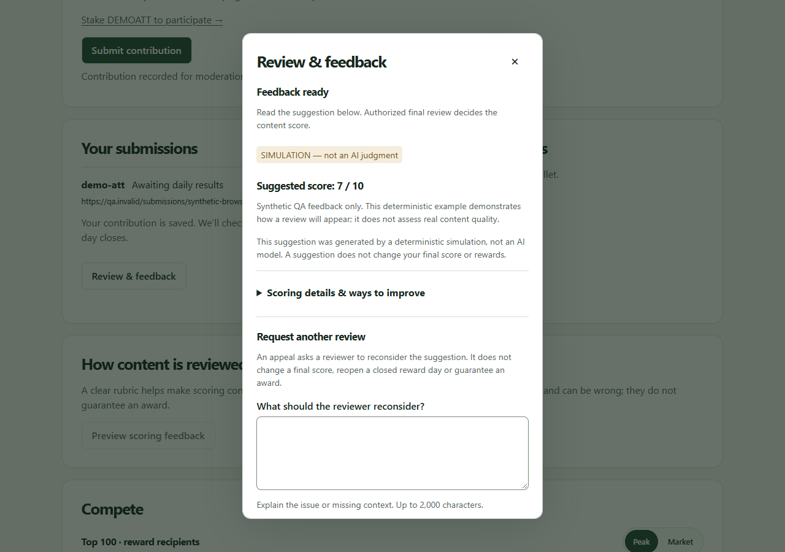
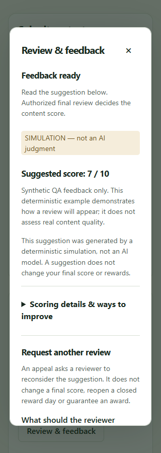
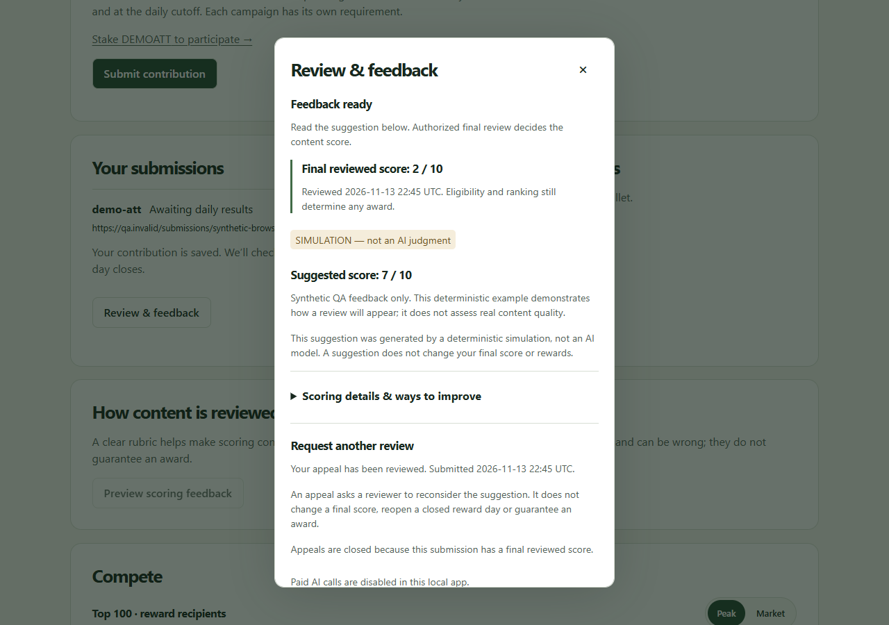

# Earn review and appeals — local user guide

14 November 2026 · Node local demo · paid AI calls disabled

## What is ready

An accepted Earn submission now creates a durable review obligation. Its creator can open private review feedback, see a suggested score separately from a final reviewed score, and request another review while appeals remain open. The local operator can capture source material and run explicitly synthetic examples. These steps do not settle rewards or execute financial transactions.

**The screenshots below use an isolated synthetic test database.** Their scores demonstrate the workflow; they are not judgments of a real post or measurements of model quality. Your wallet's content, scores and dates will differ.

## Creator: submit and follow your review

1. Open **Earn**, connect your Solana wallet and select the matching ATT campaign. The normal admission requirements still apply, including the required corresponding-token stake and available moderation capacity.
2. Paste your published content URL and choose **Submit contribution**. Wait for “Contribution recorded for moderation.” The app saves the submission and its review obligation together. Retrying an interrupted submission retains the existing submission safeguards.
3. Find the item in **Your submissions** and choose **Review & feedback**. Feedback is fetched when you open this dialog, so a long history does not trigger a separate review request for every row.
4. Use **Refresh review** after an operator has worked on it. There is no promise of an automatic completion time or background scoring. Close with the × button or Escape; keyboard focus returns to the originating button.

The submission list's **Awaiting daily results** label refers to the daily reward result. It can remain there after a reviewer has set a content score, because the list publishes its final score and eligibility with the finalized daily board. The review dialog shows the distinct moderation state.

| Review message | What it means |
| --- | --- |
| Waiting for source review | The URL is saved. An operator must capture and check the source material before it can be scored. The app does not fetch the URL automatically. |
| Ready for review | Captured evidence is ready. This does not mean an AI model has evaluated it. |
| Review in progress | An attempt has started; no result is presented until it has been validated. |
| Feedback ready | A suggestion is available. A human's authorized final review remains separate. |
| Review needs attention / Review delayed | An attempt failed validation or its interrupted outcome needs investigation. Missing feedback is not a zero score. |
| Review on hold | An operator check is needed. Real source captures remain held while paid/model processing is disabled. |
| Final review recorded | A final review exists without an accompanying saved automated suggestion, such as a historical submission. |

## Creator: understand feedback

The first view shows the overall suggestion and a short explanation. Expand **Scoring details & ways to improve** only when you want the criterion scores, rationale and suggested improvements. The rubric considers project relevance, evidence and accuracy, clarity and usefulness, and thought and craft.



**SIMULATION — not an AI judgment** means a deterministic local fixture produced the suggestion. It does not evaluate real content quality. Automated suggestions can be wrong; neither a suggestion nor an eventual content score guarantees an award. A confidence label is the reviewer's declared confidence, not a calibrated probability.

On a narrow screen, the dialog scrolls vertically and the scoring details begin collapsed:



The separate **How content is reviewed → Preview scoring feedback** panel is still an unrelated sample. To inspect your actual submission's saved state, use the button inside **Your submissions**.

## Creator: appeal a suggestion

1. Open the submission's **Review & feedback** dialog. An appeal form appears only when the current report is eligible and this runtime supports appeals.
2. In **What should the reviewer reconsider?**, describe the disputed criterion or missing context. The limit is 2,000 characters. Whitespace alone cannot be sent.
3. Choose **Send appeal** once. While it is being saved, the control is disabled. On acknowledgement, the form is replaced by **Appeal received — awaiting another review**.
4. Refresh later. A completed reconsideration displays **Your appeal has been reviewed** and the latest suggestion from a separate review attempt. The original report remains saved; the new report records its relationship to the original and the appeal.

The appeal targets the exact report shown when you submit it. A second pending appeal is not created by repeated clicks. If a request fails or its outcome is uncertain, retain the same reason when retrying or choose **Refresh review** to inspect the saved state. An unacknowledged request retains its idempotency key for that wallet, submission and reason.

An appeal is available for the latest completed suggestion, once per report, before final moderation and before the reward day closes. It cannot reopen a final score or a closed daily board. A later completed reconsideration may itself be eligible for appeal while those conditions remain true. Reconsideration does not promise a higher score or more rewards.

## Creator: final review and privacy

When authorized final review is recorded, the dialog shows **Final reviewed score** separately from **Suggested score**. A human can choose a different final score. Appeals are then closed. Settlement, daily ranking, eligibility and vesting are separate steps.



Feedback and appeals are wallet-owned reads and writes. An expired session closes the private review experience and requires sign-in again. Switching or signing out of the wallet removes the prior wallet's submission view. A wallet cannot obtain another wallet's feedback merely by knowing a submission ID.

## Operator: capture and process a local review

The browser does not grant operator permissions. Use an existing local database and an already authorized operator with the **ai-review** scope. This scope covers source capture and the local queue; it does not grant the separate **earn-review** final-moderation authority. Commands below are templates: replace each uppercase value with the corresponding existing local value.

Inspect a saved submission from a trusted local terminal:

```powershell
node platform/ai-review/queue-cli.mjs status --database DATABASE_PATH --wallet PUBLIC_WALLET_ADDRESS --submission-id SUBMISSION_ID
```

This command is local operator inspection, not a wallet authentication mechanism. Keep the database and captured source material private. Find the initial job as `submission:SUBMISSION_ID`.

Prepare a UTF-8 JSON capture with exactly these seven fields: `submissionId`, `tokenId`, `url`, `capturedAt`, `contentType`, `content`, `projectContext`. Copy the first three from the accepted submission; do not change the URL to make real content look synthetic. Use a real UTC capture timestamp no earlier than submission and no later than the current clock. `contentType` is `text` or `transcript`; capture files are limited to 128 KiB, with bounded source text and project context. See the [review module guide](../ai-review/README.md) for the input and evidence rules.

```powershell
node platform/ai-review/queue-cli.mjs capture --database DATABASE_PATH --operator-id OPERATOR_ID --job-id submission:SUBMISSION_ID --input CAPTURE_JSON_PATH --evidence-ref LOCAL_EVIDENCE_REFERENCE
node platform/ai-review/queue-cli.mjs run --database DATABASE_PATH --operator-id OPERATOR_ID --job-id submission:SUBMISSION_ID
```

Only a deliberately synthetic submission with a `.invalid` URL and captured text beginning `SYNTHETIC` can run in this local queue. Real source captures are retained on hold; there is no paid-provider or API-key option in this queue CLI. A source URL alone is not adequate review evidence. No external URL is fetched by these commands.

For a saved appeal, capture the reconsidered evidence against `appeal:APPEAL_ID`, retaining the same submission, token and URL, then run that specific job. The job preserves the prior report and appeal identity. The local test proves this recorded lineage; it does not prove organizational independence or the impartiality of a future model/reviewer.

An unknown outcome needs operator investigation. Do not repeatedly run or reconstruct a job to conceal an interrupted attempt. The queue records immutable completed reports and terminal outcomes, and uses leased attempts to prevent concurrent workers accepting conflicting results.

## Operator: final moderation and rewards

Review the suggestion and supporting material, then use the existing authorized final-review workflow. Its operator session, **earn-review** scope, preview, confirmation and revision checks remain mandatory. Queue processing never executes that workflow automatically. A suggestion is advisory even if it has no investigation flags.

Final moderation must precede the usual cutoff/settlement process. Neither capture, queue execution nor an appeal updates final scores, awards, claims or wallet balances. Synthetic fulfillment and settlement remain separate local rehearsals.

## Runtime boundaries and next work

This connected review experience is advertised only by the **Node local runtime**. Unsupported runtimes hide the per-submission feedback button and make no review request. This implementation does not add hosted Worker/D1 review processing or a production release.

Before real day-one AI scoring: approve the model/provider, costs, data handling, trusted source/media capture, rubric calibration, moderation staffing, independent reconsideration policy and production queue rollout. Add controlled provider processing and operational monitoring, and test representative real-language content and adversarial cases. AI is not inherently unbiased. The existing standalone provider adapter does not mean this app queue has paid processing enabled.

## Validation evidence

The focused browser harness is [earn-review-qa.mjs](../site/tests/earn-review-qa.mjs). It exercises normal HTTP admission, actual SQLite queue services, synthetic capture/evaluation, one saved appeal, linked reconsideration and a separate final review at 320, 390 and 1280 pixels. It also checks lazy reads, repeated-click prevention, keyboard focus return, no horizontal overflow, private-view removal on session expiry and zero review requests when capability support is absent. Browser artifacts use isolated test databases; the manual demo is not reseeded.

Installed Chromium and WebKit are compatibility checks, not a substitute for testing physical iOS Safari or every wallet browser. No real model was invoked and no financial execution occurred.
