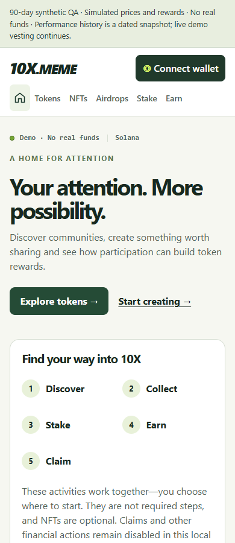
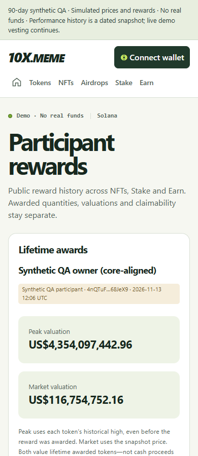

# Local app audit — 14 November 2026

Status: complete. Exact product candidate `fa6d8922479d25d77f1babb9957d1486341ff481` passed [CI43498717270](https://github.com/chrisjacob/warplets-api/actions/runs/43498717270): **1,476 tests, zero failures**, plus builds, types, contracts and recovery. Later commits contain documentation/evidence only.

Scope: the populated 90-day local QA app, its React frontend, Node server, corresponding Worker session boundary, and the recently added performance/AI review paths. The original demo database and QA snapshot are preserved. Financial execution, paid AI calls, remote resource changes and deployment remain disabled.

## Findings and fixes

| Area | Verified issue | Change | Evidence |
| --- | --- | --- | --- |
| Performance | The QA wrapper applied `no-store` to versioned public assets. Repeat visits downloaded the same scripts and styles. Direct local delivery was also uncompressed. | Preserve immutable caching only for allowlisted build assets; negotiate Brotli/gzip, support conditional requests, and bound the in-process cache to 64 files/8 MiB. HTML/API responses remain uncached in QA. | `9f0a5e0`; three focused asset tests, 35 frontend tests and before/after browser measurements. |
| Session security | Exhausting anonymous sign-in quota could prevent a signed-in user from logging out; tunneled users share a loopback quota. | Same-origin revocation bypasses issuance quota in Node and Worker. Challenge/signature limits and Origin checks remain enforced. | `30ad827`; Node auth and actual workerd/D1 integration regression. |
| Session security | Direct HTTPS auth responses lacked `Secure` on session issuance/deletion cookies. The QA wrapper already patched these, but the runtime itself did not. | Set `Secure` from the actual request URL protocol in both runtimes. Ignore forwarded protocol claims and preserve HTTP loopback compatibility. | `30ad827`; HTTP/HTTPS, header-spoofing, cross-protocol and exact-Origin tests. |
| Performance | Simultaneous cold requests repeated file reads and compression for the same asset. | Coalesce in-flight builds by URL and file version, clear failures for retry, and preserve rebuild correctness. The 8 MiB bound covers retained cache entries, not all transient request memory. | Five asset tests, including eight simultaneous requests, failed-build retry and a rebuild race. |
| Session presentation | An authenticated board could enter the anonymous query cache while session discovery was pending, then show the previous wallet's position after logout. Guest token rows also incorrectly displayed “You” because both wallet fields were null. | Public requests use both `credentials: omit` and `X-Tenx-Public-Read: 1`; the server ignores session cookies for marked boards. Personalized ranks and badges require a non-null, matching current wallet. | Delayed-session, wrong-wallet response, logout-before-cache-expiry and guest-badge browser regressions. |
| Keyboard navigation | Route navigation left focus on the previous link. Revealing more items left focus after the new items, or on the document when the last reveal button disappeared. | Move focus to the destination heading on pathname changes and to the first newly revealed item after explicit reveal actions. Initial loads and query-only changes do not trigger route focus. | Keyboard tests across populated Tokens, NFTs, Airdrops, Stake and Earn lists, including final reveals. |
| Profile pagination | Replacing the whole profile during page fetch removed its focused pagination controls. | Keep the same participant's previous page visible during fetch, block repeat actions, and retain accessible pagination controls. Never retain another participant's profile. | Delayed profile response and page-boundary tests. |
| Readability | Form outlines were too faint; Earn awards displayed internal epoch-day integers. | Increase input/select outline contrast to 3.69:1 against white and show readable UTC award dates in consumer view. Technical view retains original day values. | Computed contrast and rendered-date browser assertions. |
| Layout stability | Loading the Tokens catalogue moved the competition panel; changing the profile title and loading rewards moved visible content. | Reserve initial loading space and keep the profile page title stable, with the participant name inside the awards panel. | Targeted desktop layout shift changed from 0.109/0.101 to 0/0 in the same lab conditions. |

## Measured performance

Read-only Chromium lab runs used the same populated app, 390/1280-pixel viewports, 80 ms simulated network latency, 200,000 bytes/sec download and 4× CPU slowdown. Each route had a fresh context for cold load followed by a repeat visit. The local QA snapshot contains 90 tokens, 250 participants and 24,857 reward source records. No source rows were removed for these improvements.

| Resource transfer, excluding HTML | Before | Final candidate | Reduction |
| --- | ---: | ---: | ---: |
| Home, cold | 527,929 B | 182,099 B | 65.5% |
| Home, repeat | 527,929 B | 18,965 B | 96.4% |
| Tokens, cold | 558,456 B | 208,491 B | 62.7% |
| Tokens, repeat | 558,456 B | 41,915 B | 92.5% |
| Participant, cold | 517,466 B | 173,670 B | 66.4% |
| Participant, repeat | 517,466 B | 12,320 B | 97.6% |

Home observed LCP changed from 3.69–4.02 s to 1.87–2.02 s on cold loads, and from 3.04–3.22 s to 0.35–0.38 s on repeat loads. These are individual controlled local observations, not production percentiles or guaranteed timings. The existing tunnel already supplied transport compression; preserving asset caching benefits both tunnel and direct local browsing. Direct checks confirmed compressed immutable assets and 304 responses through both origins, while page/account/performance responses retain `no-store`.

The browser script records load paint, session-window layout shift, resource transfer, long tasks and a small set of interactions. Its interaction samples are **not field INP**. Production Core Web Vitals require representative field measurements; Google defines the metrics and percentile assessment in [Web Vitals](https://web.dev/articles/vitals). The installed browser protocol follows the [Chrome network measurement model](https://developer.chrome.com/docs/devtools/network/reference). The optional DevTools MCP connector was unavailable, so no Lighthouse score is claimed.

Final candidate `fa6d8922479d25d77f1babb9957d1486341ff481` recorded CLS 0 in all 12 measured route/width/cold-repeat cases. The slowest recorded interaction on each exercised page was 40–56 ms in the final run; these are limited lab samples.

Evidence: [final measurements](runs/2026-11-14-audit/performance-final.json), [before](runs/2026-11-14-audit/performance-before.json), [after asset delivery changes](runs/2026-11-14-audit/performance-assets-after.json). Re-run `platform/site/tests/performance-audit.mjs` with the installed `PLAYWRIGHT_MODULE`, `BROWSER_EXE`, optional `AUDIT_ORIGIN` and `AUDIT_DIR`; it performs public reads only.

## Boundaries and next review

The installed Windows WebKit 27.2 test runtime forwarded cookies despite `credentials: omit`, reproduced in a minimal app without request interception. Chromium omitted them. The server-enforced public-read marker is therefore tested with cookies present as well as absent; public `myRank` remains null, authenticated reads remain personalized, malformed markers fail closed, and the APIs remain `no-store`. This is a finding about the installed test runtime, not a claim that every Safari version behaves this way.

Local checks passed: 8 Node auth tests; 1 actual workerd/D1/R2 auth integration; Worker types; 15 performance-service tests; 37 frontend tests; frontend types/build; generated-contract checks; Earn recovery; broad Chromium operational, wallet, privacy, capability and quote regression; populated Chromium acceptance; and focused Chromium/WebKit usability/privacy checks at 320/390/1280 pixels. Modal focus/inertness and no horizontal overflow remain verified. Exact candidate [CI43498717270](https://github.com/chrisjacob/warplets-api/actions/runs/43498717270) passed: 1,267 reference + 37 frontend + 3 beacon + 169 Worker/D1/R2 tests, zero failures; see [CI evidence](runs/2026-11-14-audit/ci.json). [Acceptance evidence](runs/2026-11-14-audit/acceptance.json) separates final focused checks from the broader checks performed before the last narrow refinement. Actual tunnel checks also passed at 390/1280px.

For manual review, refresh [the local app](https://app-local.10x.meme), use Tab/Enter through navigation and Show more, page a participant's tokens through the first/last page, and sign out from a personalized leaderboard. Expect readable award dates, no guest “You” badges and no previous wallet's position after logout. The [populated workflow guide](THREE_MONTH_QA_GUIDE_2026-11-13.md) still covers the underlying synthetic workflows.

This is a focused source and local runtime audit, not an independent penetration test, hosted capacity certification or dependency-advisory clearance. Physical Trust Wallet/device and assistive-technology review, hosted security controls and launch approvals remain separate release gates. The existing real-price, AI scoring/capture/calibration and R01–R06 decisions are unchanged.

## Current review screenshots

Actual public pages through the existing tunnel, final candidate and preserved synthetic snapshot:

