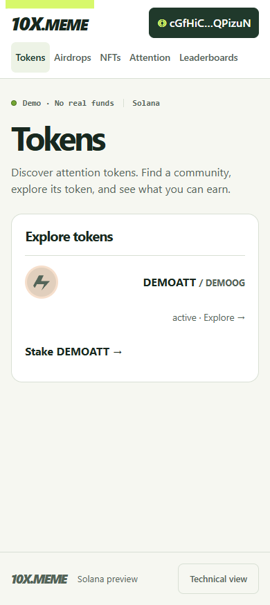
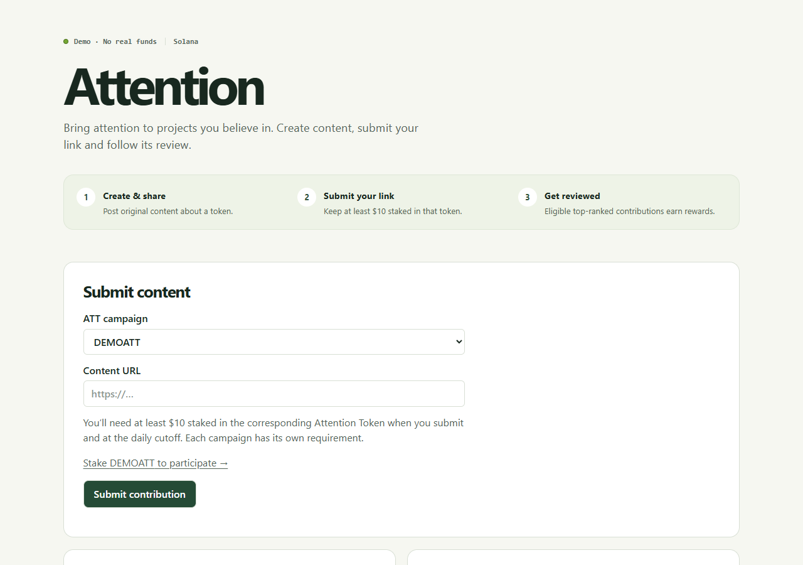
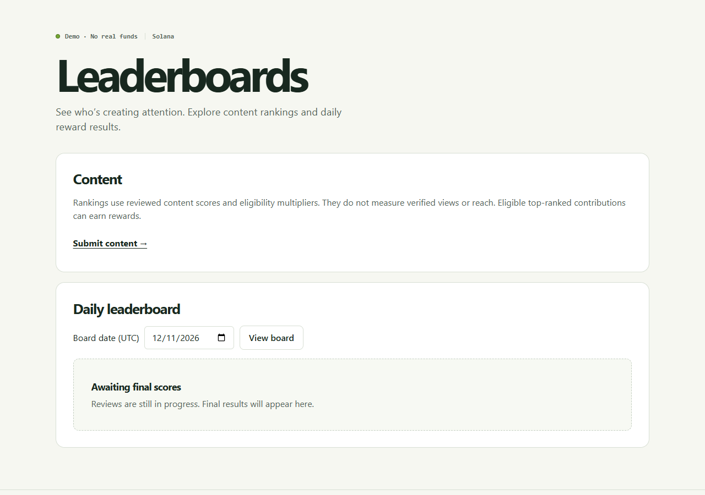

# Navigation review — 13 November 2026

The local app now uses **Tokens · Airdrops · NFTs · Attention · Leaderboards**.

| Section | URL | Purpose |
| --- | --- | --- |
| Tokens | `/tokens` | Explore Attention Tokens, open token details, or follow a token-specific staking link |
| Airdrops | `/airdrops` | Track NFT-linked allocations and their unlocking |
| NFTs | `/nfts` | Manage Genesis and Season collectibles, mint previews and progression |
| Attention | `/attention` | Submit content, follow reviews and see personal award history |
| Leaderboards | `/leaderboards` | Content rankings and settled daily results, with a UTC date selector |

Staking remains at `/stake`, reached from token-list cards, token details, the selected Attention campaign, and **My stakes** inside the wallet dialog. Its top-level navigation item has been removed. Staking CTAs preserve the token ID in the `farm` query parameter. A $10 stake in the corresponding Attention Token is required at submission and daily cutoff; one stake does not unlock every campaign. Existing disabled financial capabilities remain disabled.

Attention and Leaderboards are separate screens. Attention has the submission form and history; Leaderboards has the date picker and ranked results, with a **Submit content** link back to Attention. Only the implemented Content category is shown. PnL and other future rankings have not been added. Reviewed content scores are not presented as verified reach or views.

## Review checklist

1. Refresh https://app-local.10x.meme/tokens. Confirm the five navigation labels and token-specific **Stake** link.
2. Open a token and follow **Stake this token**. Confirm the correct campaign is selected.
3. Open **Attention** while signed in. Select a campaign and follow its staking link; return and check the submission form and history.
4. Open **Leaderboards**, select a date, reload and confirm the selected date is retained. **Submit content** returns to Attention.
5. Open the wallet dialog, then **My stakes**. Confirm the dialog closes and positions are accessible.
6. Review Airdrops and NFTs using the previously tested demo assets.

## Compatibility and validation

Old `/markets`, `/vault`, `/collect`, `/earn` and dated `/earn/YYYY-MM-DD` links remain usable. Existing token-detail URLs and operation receipt search parameters remain supported. Dated legacy leaderboard links retain their canonical URL. New routes are handled on direct server requests as well as client navigation.

TypeScript, Vite build and 30 component/API tests passed. The full existing browser acceptance suite passed after updating labels to the new names, retaining wallet, recovery, financial pagination, capability and quote checks. The retail layout/keyboard suite passed. Dedicated navigation acceptance passed in Chromium and WebKit and covers 320, 390, 844 and 1280-pixel widths, staking links, wallet-menu access, legacy routes, date reload and signed-out access. Tests use disposable synthetic fixtures. The live demo was restarted in reuse mode without reseeding, refreshing staffing or stake evidence, or changing operator credentials.

This is local validation of the navigation change. The earlier full CI result remains pinned to its recorded UX commit; no new release approval or deployment is implied. Physical mobile/wallet and real retail-user review remain part of the release checklist.
