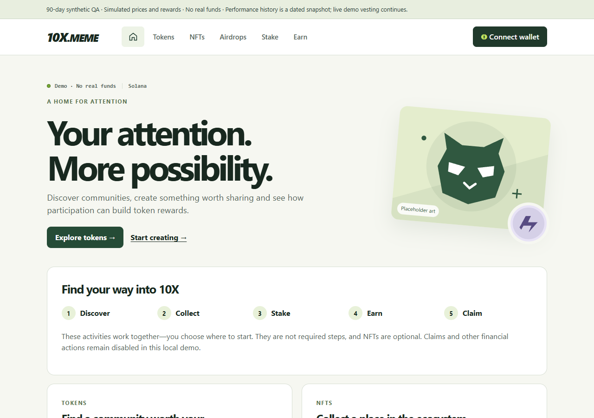
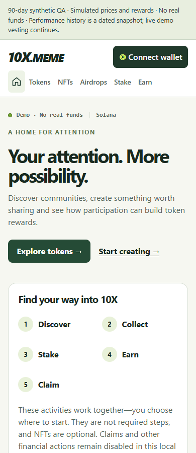
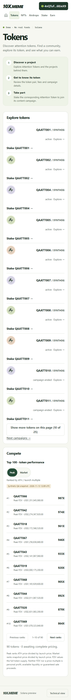
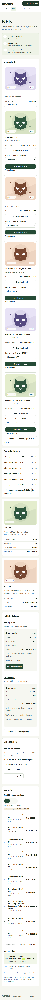
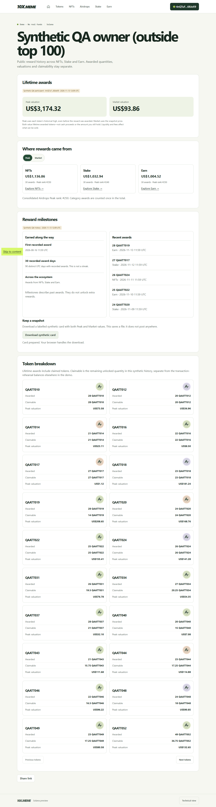
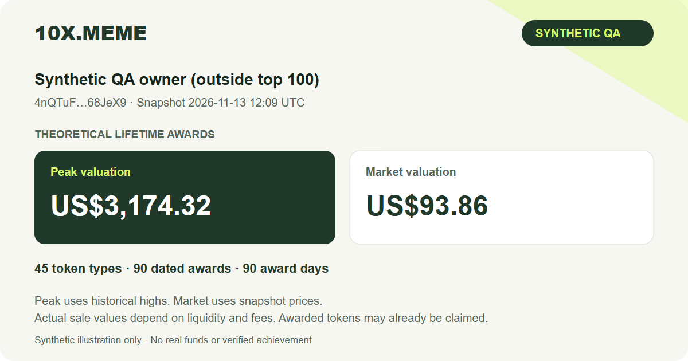
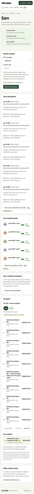
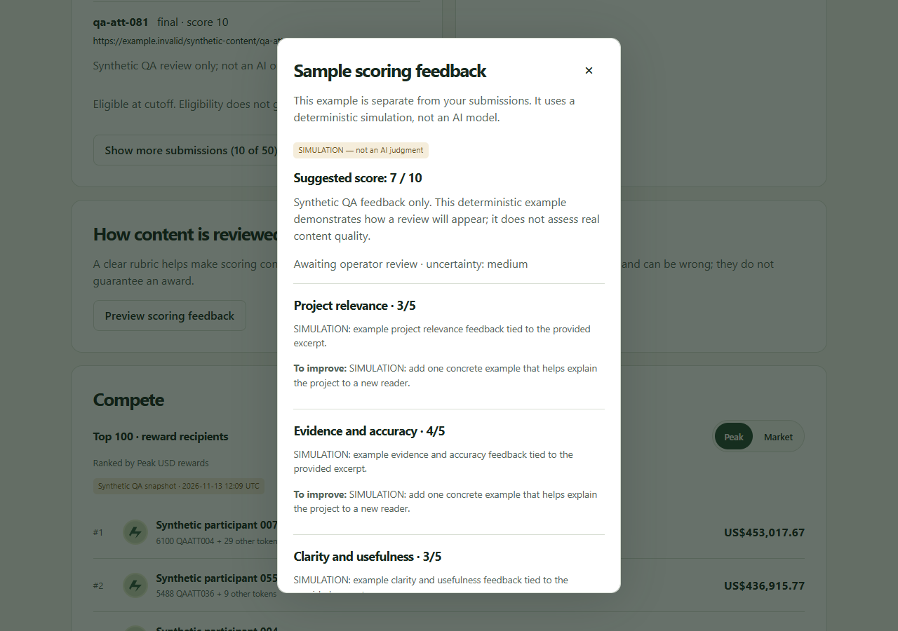

# Three-month local app review

**Review goal:** decide whether a busy 10X.MEME still feels simple to discover,
join and use. The app now has Home, Tokens, NFTs, Airdrops, Stake and Earn,
with compact performance rankings inside each section. This is a synthetic local
preview: it contains populated history, but no real funds or enabled financial
execution. AI feedback is a clearly labelled sample, not automatic judging of
your submissions.

## Open the right preview

Use [app-local.10x.meme](https://app-local.10x.meme). Its existing local tunnel now
points at the populated QA app on port **4181**. If the tunnel is unavailable,
the local process can be opened at `http://127.0.0.1:4181` when it was started
with that local origin. Use the origin configured for the process for wallet
sign-in; do not mix the HTTPS and loopback sessions.

Look for the **90-day synthetic QA** banner. The original manual demo database
is separate and has not been replaced by this scenario. The populated scenario
is `work/qa-three-month-final-2026-11-13`, with performance measured as of
**13 November 2026, 12:06:14 UTC**.

| Included in this scenario | Count |
| --- | ---: |
| Tokens launched across 90 days | 90 |
| Synthetic participants | 250 |
| Distinct reward records in performance history | 24,857 |
| Revealed NFTs in the local collection ledger | 183 |
| NFTs held by your selected demo wallet | 57 |
| NFTs held by the large-holder example | 126 |
| Your recorded stake positions | 90 |
| Your historical contributions and final boards | 90 each |
| Recorded Earn allocations | 89 |
| Pending mint reservation | 1 |

The selected wallet is
`4nQTuFuY38vevToXAuMwT3nm4SFVfuRRWMEXRm68JeX9`. Connect it through the wallet
menu to review the populated member experience. This separate database requires a fresh message sign-in; a session from the original demo will not carry over. No private key or seed phrase
is needed by the app or QA generator.

The Home screenshots were captured through the running tunnel against the final aligned scenario. Member-screen and card screenshots use the isolated 22,502-record synthetic browser-test fixture; exact names, totals, ownership and dates can differ. Use the running app and its snapshot labels when checking amounts.

## A first visit: understand the app before connecting

Start at **Home**, available through the house icon. You should immediately see
what participation means, two obvious ways to begin, and a simple sequence:
Discover, Collect, Stake, Earn, Claim. These are ways to participate, not five
mandatory steps. NFTs are optional.

Try these actions while signed out:

1. Follow **Explore tokens** and then return Home using the house icon.
2. Scroll through the five category introductions. Each includes only the top
   three performance entries, with a link to its fuller ranking.
3. Switch a preview from **Peak** to **Market**. The ranking and metric should
   change together. A higher historical peak does not guarantee today's rank.
4. Follow a participant name to their public reward profile. Browsing public
   history should not require a wallet connection.
5. Read the five recent awards near the bottom. They should feel like a short
   activity sample, not an endless feed.

Decide whether the first screen explains the product without needing the
technical-details toggle. The footer toggle is for investigation; leave it off
for the main retail review.

## Tokens: browse, understand a pair, then choose an action

Open **Tokens**. Read its three-step introduction, browse the catalogue and
open a token. The list initially shows ten token rows. **Show more tokens on
this page** reveals another ten, and **Next campaigns** moves to the next
server page. Ninety historical launches should not become ninety rows at once.

On a detail page, check that you understand which Attention Token and underlying
project token form the pair, the campaign's state, and where its staking action
leads. Labels and placeholder token art should help you recognize items without
reading long addresses. Financial actions remain disabled in the demo.

Then find **Compete** on Tokens. It ranks tokens by price multiple, not by
participant rewards. The top 100 is displayed ten rows at a time; this scenario
has 90 tokens. Try **Next ranks**, **Previous ranks**, Peak and Market, and
open a token directly from its ranking entry.

## Connect as a member

Choose **Connect wallet** and select your wallet explicitly. For this local
preview, authentication signs a message. It does not require a transaction,
funding or a token transfer. The connected address should match the selected
demo wallet above.

The wallet menu lets you review the connected identity, access **My stakes**,
and switch or disconnect. After disconnecting, private holdings and submissions
should no longer appear as yours. Public performance profiles remain public.

## NFTs: recognize what you own and find its next action

Open **NFTs** while connected. In **Your collection**, six NFT cards are shown
initially. **Show more NFTs on this page** reveals twelve; **Next assets** moves
through the paginated holdings. Your 57 assets should be browsable without a
single wall of 57 cards. Desktop uses three cards across, medium widths use two and phones use one. Mint stages start with two collection sections; **Show more collections** reveals two more. Operation history starts with six receipts.

Review these examples:

1. Open a Genesis item and a Season item. Check that permanent membership and a
   time-limited Season benefit are understandable, with Level and visual identity
   easy to locate.
2. Inspect the collection and asset detail links, then return to your collection.
3. Find the pending mint receipt. It should say it is awaiting evidence, not
   imply that a paid mint has completed. The fixture includes one deliberate
   pending reservation for this state.
4. Open an eligible upgrade or visual-reroll review if available. Read the terms,
   then close it or press Escape. A preview request and fulfillment are separate
   steps; opening a dialog must not change the NFT.
5. Scroll to the NFT performance ranking. A participant's NFT reward value is
   the value of token awards from NFTs, not an appraisal of their NFT collection.

Some historical Season benefits have expired. An expired current benefit does
not erase its historical token allocation. Placeholder artwork is illustrative;
it is not a commitment to final collection art.

## Airdrops: distinguish lifetime rewards from what is unlocked

Open **Airdrops**. Start with **Your lifetime rewards** and follow **View your
reward breakdown**. Peak and Market are valuations of lifetime token awards;
the operational rewards below describe local holdings and unlocks. Holdings and reward lists start with six rows, with Show more controls and separate server-page links.

On your profile:

1. Inspect the NFT, Stake and Earn category totals. Airdrops combines these
   sources once; it is not another source of awards.
2. Switch the category breakdown between Peak and Market.
3. Read a token's **Awarded**, **Claimable** and valuation fields. Awarded includes
   rewards already collected; Claimable is the remaining unlocked amount in
   this dated synthetic history.
4. Use **Next tokens** and **Previous tokens**. Profiles show twenty token types
   per page; your selected wallet has ninety.
5. Inspect **Reward milestones** and the five most recent awards. First recorded award, 30 distinct recorded UTC award days and participation across all three sources describe recorded history; they do not grant extra rewards or imply an unbroken streak.
6. Choose **Download synthetic card**. Open the saved SVG and confirm it includes both valuations, the snapshot date and prominent synthetic/theoretical labels. This only downloads a file; it posts nothing. Missing prices disable the download.

The chosen owner's 2,445 performance reward records were derived from the same
local readers used by the operational app: 2,266 NFT allocations, 90 accrued
stake rewards and 89 Earn awards. They agree at the snapshot timestamp.
The 90 staking rows are cumulative accrual snapshots. They count in valuations, but are excluded from dated recent awards and award-day milestones because individual distribution dates are unavailable. The profile says this explicitly. Its dated record count is 2,355; the overall source-record count is 2,445.

Operational vesting continues afterward, while performance history remains a
snapshot. A later live available balance can therefore differ legitimately.

Other participants' performance histories are separately simulated; they do
not all have operational balances that can be claimed. Do not add a profile
total to the operational balance. No claim or withdrawal is enabled here.

The large-holder example intentionally exceeds the existing 100-asset complete
snapshot limit. Its operational summary may be withheld rather than showing
an incomplete subtotal. That state needs a clear explanation, not a misleading
zero.

## Stake: understand an existing position

Open **Stake**, or use **My stakes** from the wallet menu. Read the three steps,
open a campaign and inspect your positions. You should be able to distinguish
what was staked, rewards available and rewards already collected. Campaign and position lists start with six rows each; reveal more only when you need them. **Next campaigns** and **Next positions** page through their own 25-record API pages independently, retaining the selected farm.

This scenario has ninety historical positions, with ten-day campaigns spread
across the 90-day history. They are not ninety simultaneously active campaigns.
Some are ended while others remain active. Use the position pagination and
check that an ended campaign still exposes its recorded reward history.

Stake performance ranks lifetime awarded staking rewards. It excludes future
emissions that have not accrued. The fixture uses zero harvest fees for direct
quantity comparison, but that does not set production fee policy. Operational
readouts that say **raw token units** are base units, not dollar amounts.

## Earn: submit, understand a review, follow an award

Open **Earn**. The intended creator journey is: choose a token, establish the
corresponding qualifying stake, publish original content, submit its link, then
follow review and any awarded tokens. A qualifying corresponding stake is
required at entry and cutoff; NFT ownership is optional.

For this populated history review:

1. Inspect **Your submissions** and **Your vested awards**, including subsequent
   pages. Historical scores should not be confused with dollar valuations.
2. Open **Daily content scores** and choose a historical date with submissions.
   Today's board can be empty: the seed creates historical contributions, not
   artificial new submissions every time the server starts.
3. Compare the daily content board with Earn's **Compete** section. Daily content
   scores support reward allocation; the performance ranking values lifetime
   Earn awards. Neither claims to measure verified views or social reach.
4. Check that an unavailable or expired eligibility condition gives a useful
   next step. The generator does not continually refresh stake evidence or
   open staffed admission. Do not weaken those checks to force a new submission.

Existing local contribution and settlement rehearsal remains separate. A fresh
end-to-end submission needs current synthetic stake evidence, open staffed
admission and an authorized reviewer. A pending review is not yet an award,
and a final review is not a claim transaction.

### Preview content feedback

Choose **Preview scoring feedback** under **How content is reviewed**. The
modal should explicitly say **SIMULATION — not an AI judgment**, show a sample
suggested score of 7/10 and explain four criteria: project relevance, evidence
and accuracy, clarity and usefulness, and thought and craft. Each criterion
includes a reason and an improvement suggestion. Close with Escape and check
that keyboard focus returns to the opening button.

This fixed sample is separate from your submissions. It makes no model request,
changes no score and settles no reward. It demonstrates the creator experience. Submission and award histories start with five entries each.

A real model adapter and bounded local batch runner are implemented separately.
They require explicit provider/model configuration, captured content and paid
opt-in; no real-model request was made for this review. Even a valid suggestion
requires the existing authorized final-review process. Automatic day-one final
scoring is not enabled. AI can improve consistency and scale, but it is not
inherently unbiased or always correct.

## Read the performance numbers correctly

For each awarded token:

| Display | Calculation | Meaning |
| --- | --- | --- |
| Participant Peak | Lifetime awarded quantity × that token's accepted historical high USD price | A theoretical historical valuation; the high may predate the award |
| Participant Market | Lifetime awarded quantity × snapshot USD price | A dated valuation, not a live wallet balance |
| Tokens Peak multiple | Historical high price ÷ launch price | Relative token price performance |
| Tokens Market multiple | Snapshot price ÷ launch price | Relative price at the snapshot |
| Token FDV | Full token supply × selected price | A supply valuation, not available liquidity |
| Claimable quantity | Vested units − already claimed units | Remaining unlocked token quantity in the relevant ledger or snapshot |

Participant totals sum per-token valuations. Peak can combine highs reached
at different times; it does not represent one simultaneously achievable sale.
Prices are computed from the token pair and a contemporaneous underlying-token
USD observation. Short accepted peaks are retained; rejected quotes do not
become ATH. Fees, liquidity, slippage and subsequent sales are not modeled as
realized profit.

Default prices are complete so the populated experience has meaningful totals.
The optional price-gaps scenario deliberately withholds missing or stale values.
Missing is **Unavailable**, never zero, and incomplete constituent values must
not produce a deceptively complete total.

Each section displays ten of its top 100 ranks per page. The selected wallet
is rank 1 for Airdrops Peak in this final fixture. The public example
`8BrP6Wq8J1Ah6Bf3m9ir8sFTrtoszstwebwDxbvddDV6` is rank 247 and demonstrates
history beyond the top 100. A connected outside-top-100 participant gets a
separate **Your position** row; generated participant addresses have no supplied
private keys and should not be treated as accounts you can sign into.

## Operator and founder review

Operators should review the populated app as a member first. Keep the operator
console private and use its existing scoped review, preview and confirmation
process. The public QA feedback endpoint exposes only the safe sample feedback,
not captured source content or private review artifacts.

For an AI-assisted rehearsal, use the [AI review guide](../ai-review/README.md).
Capture the post and supporting context, produce a suggestion, inspect its
evidence and flags, and create an explicit review-input draft only after
acceptance. A failed provider call is a failure to review, not a zero score.
Preserve the original report and any appeal lineage. Finalization, settlement
and reward publication remain separate authorized operations.

For reset/reproduction commands and detailed fixture boundaries, use the
[populated QA guide](../qa/README.md). Generate a new `qa-` directory instead of
overwriting this scenario or the original manual demo.

## What to record during your review

At desktop and phone widths, record the page, connected state, exact action,
expected result and what felt confusing. A screenshot of the confusing state
is more useful than only saying a page feels busy.

Focus on whether you can find the primary action without technical details,
recognize tokens/NFTs visually, understand disabled or pending actions, and
tell a token quantity from a dollar valuation. Use Tab/Shift+Tab and Enter,
open and close dialogs, switch Peak/Market and move between pages. Look for
horizontal scrolling, inaccessible controls, lost focus or a long wall of data.

Automated Chromium and WebKit checks cover 320, 390 and 1280-pixel viewports,
ranking/page bounds, mode changes, profiles and horizontal overflow. Browser
emulation does not replace physical Trust Wallet/iOS/Android checks or a screen
reader review. Local data volume also does not prove production throughput.

## Decisions and work before moving beyond this demo

| Area | Concrete next decision or work |
| --- | --- |
| Retail design | Review navigation, language, visual hierarchy, data density and final artwork; record changes from this populated walkthrough |
| Performance data | Select trusted quote sources and launch baselines, quote-quality rules and freshness policy; implement durable ingestion/publication and production reward-source reconciliation |
| AI scoring | Select provider/model, authorize costs and retention, establish trusted post/media capture, calibrate on representative content and decide human-review/appeal policy |
| AI operations | Add a production durable queue, cross-run idempotency, daily cost/rate caps, monitored failure recovery and audit retention before live volume |
| Appeals | Decide the review window and how later corrections interact with immutable final reviews and settled rewards |
| Growth and history | Current cards and milestones are synthetic previews. Verified public achievements and historical ranking charts need durable reviewed snapshots and an agreed period/tie policy; personal PnL needs actual trades and cost basis |
| Compatibility | Finish physical wallets/devices and NVDA/VoiceOver/TalkBack checks; preserve known distinctions between simulated and real-provider evidence |
| Hosting rehearsal | Prepare an exact non-financial environment, private operator access, backup/restore, monitoring, rollback, costs and tester scope for separate approval |
| Financial release | Resolve custody/burn/mutation and principal-protection blockers; independently review protocol choices and actual execution/finality evidence |
| Launch operations | Choose staffed Sydney launch hours and later mint prices; these remain open |

Review the [local-to-release checklist](LOCAL_TO_RELEASE_REVIEW.md) and mandatory
[R01–R06 release gates](../blueprint/RELEASE_GATES.md) before authorizing any next
environment or funded pilot. This walkthrough, working UI and synthetic test
results do not authorize deployment, provisioning, paid calls, funding or
transaction broadcasting.

## Developer restart and rollback

The QA process uses `platform/qa/serve.mjs --directory work/qa-three-month-final-2026-11-13 --port 4181 --origin https://app-local.10x.meme`. It reuses the existing fixture and does not reseed on restart. The original manual app remains on port4180 with its separate `work/manual-earn-2026-11-12.sqlite` database. The operator console remains separate; this QA server does not expose operator authorization.

The local tunnel configuration is `work/app-local-tunnel.yml`. Its pre-QA copy is `work/app-local-tunnel.before-three-month-qa.yml`. To return to the original demo, verify the original process is healthy, restore that local configuration and restart only the identified app-local connector. No DNS, remote tunnel resource or deployment change is needed. Local configuration validation follows [Cloudflare’s configuration guide](https://developers.cloudflare.com/cloudflare-one/networks/connectors/cloudflare-tunnel/do-more-with-tunnels/local-management/configuration-file/).

Keep the computer awake for the local server and tunnel to stay available. Refresh the browser after an asset rebuild. Generate a new directory when you want a new dated scenario; do not overwrite the manual database or this snapshot. Re-generating history does not authorize real pricing, funding, transactions or provider calls.
