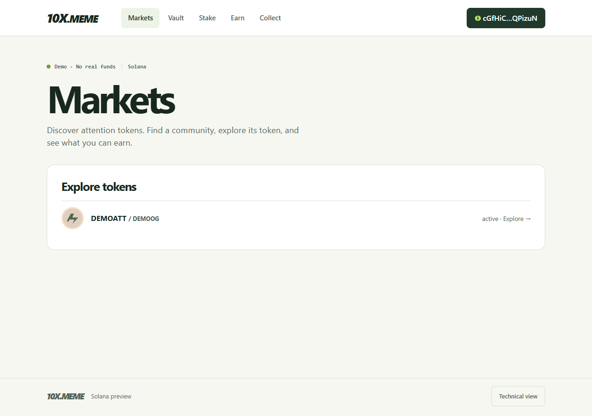
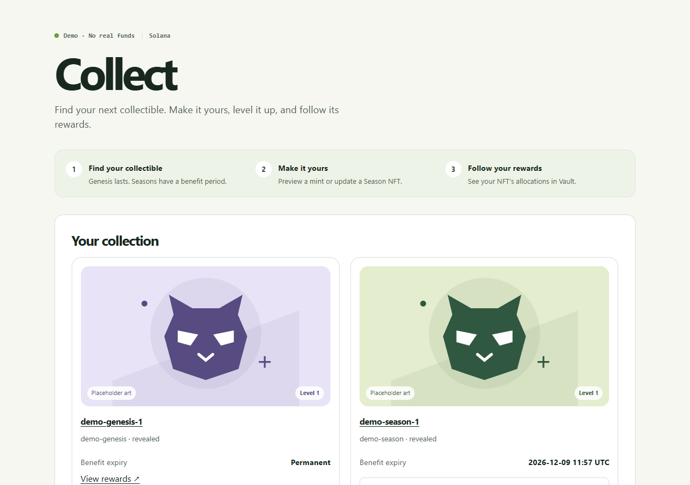
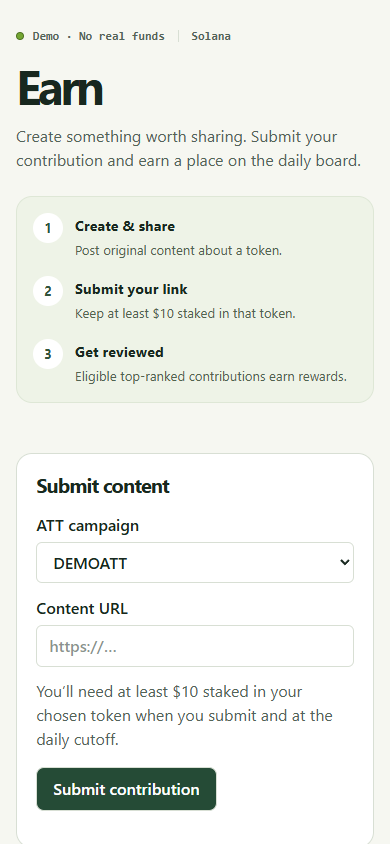

# Consumer UX audit and review guide — 12 November 2026

The default experience now leads with personal assets, useful actions and short explanations. Technical evidence remains available through one **Technical view** switch in the footer. This is a local synthetic demo, not a release approval.

## Audit findings and implemented changes

| Usability problem | Implemented improvement |
| --- | --- |
| Protocol metrics, evidence and policy appeared before the user's task | Plain-language page introductions; personal actions and balances first; diagnostic metrics and provenance opt-in |
| Collections looked like database records | Illustrated NFT cards, clear Level badges, visible expiry, and consistently labelled placeholder art |
| Tokens had no visual identity | Lightweight local SVG token icons, with deterministic colours and no external image requests |
| Upgrading required typing an exact NFT ID | A dropdown of eligible same-owner, same-Season, same-Level NFTs; the existing server checks still apply |
| Long mint-stage lists dominated Collect | Closed stages hidden in simple view; available stages show price, stock, limit and deadline; detailed costs remain in the review dialog |
| Reward and staking tables were difficult to scan | Simple staking cards, available Vault rewards and unlocking progress graphics; technical tables retained |
| Users had to infer the Earn process | A three-step visual guide, contribution form before the board, clear submission and award states |
| Swap terminology required prior expertise | Percentage slippage choices in simple view; basis-point input retained in Technical view |
| Material downgrade risk was inside a disclosure | The risk now appears directly in the upgrade review; detailed probabilities remain available |
| Multiple technical expanders competed with normal tasks | Diagnostic details moved behind the single view switch; operational recovery and required review disclosures retained |

Artwork is illustrative, not actual NFT metadata. Concealed NFTs use a question-mark placeholder and do not reveal Level or traits. A subtle hover movement adds feedback; reduced-motion settings suppress it. The step diagrams and reward progress bars explain processes without continuous animation.

## Review the updated app

Open https://app-local.10x.meme and refresh. Use the wallet you already tested. Your persistent demo database has not been reseeded; the server refresh preserves operator credentials and does not refresh synthetic stake evidence or staffing.

### Visitor: discover a token

1. Open **Markets**. Token discovery appears first, without allocation charts or internal metrics.
2. Open a token to see its status and fee, then preview its trading terms.
3. Slippage choices use percentages. Quotes remain previews; no real transaction is sent.

### Collector: review and update an NFT

1. Open **Collect**. Your NFTs appear above collection policy and mint listings.
2. Check each card's Level and benefit expiry. The picture is explicitly labelled **Placeholder art**.
3. For a Season upgrade, select an eligible NFT from **Pair with another Level…** and choose **Preview upgrade**.
4. Read the fee, unknown network/total costs, expiry and potential material downgrade before recording a request. Review actions remain synthetic.
5. For a visual change, choose **Preview visual reroll**. Waiting requests and their history remain visible.
6. Open **View rewards** from an NFT to inspect its Vault allocations.

### Contributor: submit and follow an Earn contribution

1. Open **Earn** and follow **Create & share → Submit your link → Get reviewed**.
2. Select a token and enter the published content link. At least $10 of corresponding token stake is required at submission and cutoff; synthetic eligibility can expire.
3. Follow the result under **Your submissions**, then **Your vested awards**. Submission and eligibility do not guarantee a ranked award.
4. Use the board date to inspect a settled day. Moderator/founder authority stays in the separate operator console; retail UI changes do not grant it.

### Holder: check Vault and Stake

- **Vault** shows available rewards with an unlocking progress bar. Selling an NFT transfers its remaining rewards; Season expiry preserves past allocations.
- **Stake** shows the principal and rewards before fees in cards. Deposits and withdrawals remain disabled in this demo.
- Amounts without a verified decimal mapping remain explicitly labelled raw token units. The UI does not invent token prices or decimal precision.

### Technical reviewer

Use **Technical view** in the footer to restore evidence, provenance, detailed policy metrics and closed stages. Use **Switch to simple view** to return. The choice persists for the browser tab. This is a display preference, not an authorization mechanism: existing authentication, capabilities and owner checks still apply.

## Verification

[CI 43213951964](https://github.com/chrisjacob/warplets-api/actions/runs/43213951964) passed on `3e9d06b`: **1,430 tests, zero failures** (1,228 reference, 30 frontend, 3 beacon, 169 local Worker/D1/R2). The subsequent `27b482e` custom-slippage/selection-bound follow-up passed local types, build and targeted browser checks; the CI result is pinned to its own commit, not represented as an exact-head run. Structured evidence is in `ux-2026-11-12/results.json`.

- TypeScript and Vite production build passed.
- 30 frontend component/API tests passed.
- Full existing browser workflow acceptance passed in Technical view, including collection recovery, real-API financial pagination, wallet boundaries, capability gating and quote behaviour.
- Consumer acceptance covers five routes at 320×568, 390×844, 844×390 and 1280×900, plus signed-out navigation, simple/technical switching and persistence, eligible material selection, explicit downgrade/cost disclosures, dialog focus and overflow checks.
- Consumer checks passed in pinned Chromium, installed Edge 157 and WebKit 27.2. WebKit's skip-link activation uses explicit focus because its default platform setting skips links in Tab navigation; this is not evidence of a physical Safari or iOS test.
- The incidental inbox conflict investigation identified a 1 ms clock discrepancy between JavaScript and SQLite. The Node inbox adapter now samples SQLite's clock, matching its guarded write. Nine focused clock/consent tests passed, including unchanged expiry, stale revision and generation protections. Deterministic delayed-read/rapid-toggle/other-tab/pending-response inbox browser checks passed.

Exact local logs are retained under `work/ux-*.log`; reproducible consumer checks are in `platform/site/tests/retail-qa.mjs`. Screenshots use a disposable synthetic fixture, not the personal demo wallet.

## Remaining design and release work

1. Have retail users perform the five primary tasks without coaching; measure task completion and misunderstandings. This implementation audit is not a user research study.
2. Supply approved NFT artwork, token logos, collection display names and verified token decimal metadata. Keep synthetic and unknown-value labels until real sources replace them.
3. Test physical iOS/Android wallets, Safari and assistive technologies before release; desktop emulation does not replace them.
4. Re-review the release gates in `LOCAL_TO_RELEASE_REVIEW.md`. Financial execution, remote infrastructure changes and deployment remain separately gated. Sydney launch hours and later mint prices remain undecided.
